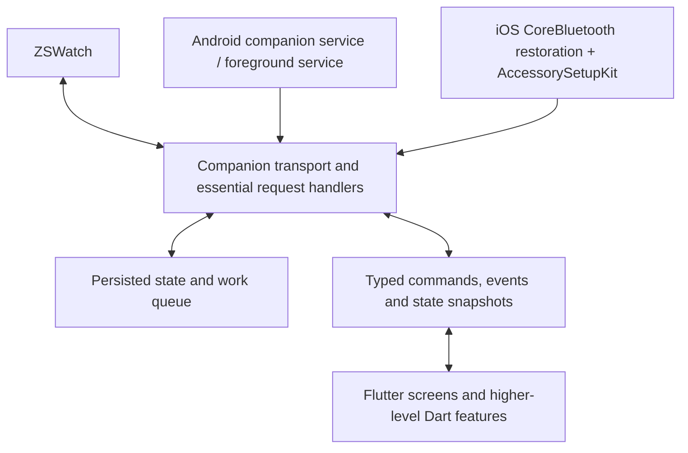

# ZSWatchApp background reliability: research and recommended direction

Research date: 2 October 2026. Based on the local app and watch firmware, FlutterBluePlus 2.0.2 with locally resolved Android/Darwin implementations 8.0.1, and the primary sources linked below. This is an architecture assessment, not a verified device reliability result. No application code was changed.

Follow-up: the user identified HTTP, notifications, time and voice memos as essential, including remote and local AI processing. The updated recommendation and an inspection of current Gadgetbridge upstream are in [GADGETBRIDGE_AND_VOICE_PIPELINE_RESEARCH.md](GADGETBRIDGE_AND_VOICE_PIPELINE_RESEARCH.md). Those priorities make recording receipt, durable AI jobs and eventual watch-result delivery part of the initial acceptance gate.

## Recommendation

Keep Flutter. Make the watch companion core independent of the Flutter UI lifecycle, with platform-specific ownership of recovery and critical work. First prove the lifecycle on actual phones before deciding how much protocol logic to move into native code.

An Android service-owned Flutter engine is a credible intermediate option for retaining Dart logic. For iOS, investigate native CoreBluetooth restoration and AccessorySetupKit immediately. Prefer native handling of the minimum essential watch requests if starting Dart takes too long or restoration events are lost. A complete Kotlin/Swift UI rewrite does not buy exemption from operating-system lifecycle rules.

With voice memos and HTTP essential, prefer native lifecycle ownership of transport, recording persistence and OS background network transfers. Keep the headless-engine option as a bounded Android experiment; require it to pass the full recording-to-result flow, not just retain a BLE connection. Local models remain a supported worker option and should not be loaded by the connection core.

Define the requirement as: ordinary backgrounding requires no intervention; recover automatically from supported process termination; handle bounded watch requests while the UI is absent; preserve work across interruptions; make unavailable states explicit. An immortal process and uninterrupted radio/network access are not realistic acceptance criteria.

## What the current implementation actually does

| Finding | Local evidence | Consequence |
| --- | --- | --- |
| Android already declares a `connectedDevice` foreground service. | `zswatch_app/android/app/src/main/AndroidManifest.xml` | The basic OS integration exists; adding another notification wrapper alone will not fix recovery. |
| The service explicitly delegates BLE to FlutterBluePlus; it neither creates a Flutter engine nor owns GATT. | `BleConnectionForegroundService.kt` | A service restart does not reconstruct the working companion. |
| `START_STICKY` is returned, but `onStartCommand` has no null-intent recovery branch. | `BleConnectionForegroundService.kt:176` | A sticky restart does not restore persisted intent, promote through this branch, or reconnect. Android documents null intents on sticky restart in its [Service reference](https://developer.android.com/reference/android/app/Service). |
| Boot/update recovery only starts the service with a reconnecting notification. | `BootReceiver.kt:34` | The watch identity is persisted, but no transport or Dart startup follows. |
| Removing the task changes the notification to “Reopen ZSWatch to restore BLE.” | `BleConnectionForegroundService.kt`, `onTaskRemoved` | Current behavior anticipates loss of the companion. Task removal is a lifecycle signal, not universal proof that the process died. |
| Notification/media bridges are installed in `MainActivity`; destruction clears the notification callback and disposes the media bridge. | `MainActivity.kt:137`, `MainActivity.kt:1204` | Even preserving BLE alone may leave notification and media forwarding broken. |
| BLE and HTTP/GPS handlers initialize after the Flutter widget's first frame. | `zswatch_app/lib/app.dart:48` | Recovery is coupled to rendering a UI. A background entry point must initialize essential handlers directly. |
| iOS declares `bluetooth-central`, but app code never calls `FlutterBluePlus.setOptions(restoreState: true)`. | `Info.plist:72`; search of `zswatch_app/lib`; plugin source | Restoration is opt-in and disabled by default in the installed plugin. Background mode and restoration are separate requirements. |
| The installed iOS plugin creates its central manager lazily after Dart method calls; it does implement `willRestoreState`. | Local `flutter_blue_plus_darwin-8.0.1` source | Try explicit restoration first, but audit startup timing and callback delivery. A plugin swap is not automatically necessary. |
| Connection setup proactively disconnects an existing device before connecting. | `ble_connection_service.dart`, `_connectToDevice` | A restoration path must adopt restored connections instead of automatically tearing them down. |
| Reconnect scheduling and five-second GPS polling are Dart timers. | `ble_connection_service.dart`; `gps_providers.dart` | These are not independent OS wakeup mechanisms. |
| HTTP relay has a 30-second timeout; on-device AI is also present. | `http_relay_service.dart`; `services/ai` | A successful BLE wakeup is not proof that slow requests or AI can finish in the background. |
| The BLE abstraction exposes FlutterBluePlus device/service/characteristic types. | `ble_service.dart`; connection and GATT services | Replacing transport requires a real interface refactor, not just one alternate implementation. |

The installed Android FlutterBluePlus plugin explicitly disconnects all devices when detached from its engine. That explains why retaining a foreground service without retaining or reconstructing the BLE-owning engine is insufficient.

The existing `IOS_BLE_BACKGROUND_PLAN.md` is directionally useful, but its blanket force-quit limitation is outdated for the AccessorySetupKit path described next.

## Platform mechanisms and limits

### Android

Google recommends companion-device presence/service APIs for long-lived peripheral listening and also supports `connectedDevice` foreground services. Process death closes GATT connections. Companion association and the appropriate permissions provide supported recovery/start opportunities; association itself does not implement GATT. Validate watch addressing against the documented companion-manager limitations. See [BLE background guidance](https://developer.android.com/develop/connectivity/bluetooth/ble/background) and [companion pairing](https://developer.android.com/develop/connectivity/bluetooth/companion-device-pairing).

Use `CompanionDeviceManager` association and `CompanionDeviceService` on supported versions, with a service fallback for older supported phones. Persist recovery intent and rebuild the actual companion core after OS restarts. Handle boot/update as reconstruction, not just a status notification. Avoid periodic scans as the primary recovery mechanism.

The six-hour Android foreground-service limit discussed for Android 15 applies to `dataSync` and `mediaProcessing`, rather than the existing `connectedDevice` type. `shortService` has separate, shorter limits. See [foreground-service timeouts](https://developer.android.com/develop/background-work/services/fgs/timeout). This is useful for selecting the correct service, not a promise of immunity from termination.

Settings “Force Stop” is distinct from removing a recent-app task. Android's stopped state requires user interaction to leave it; do not promise recovery from Force Stop. See [Android stopped-state behavior](https://developer.android.com/about/versions/15/behavior-changes-all#stopped-state). Test manufacturer behavior directly, including at least Samsung and an aggressive battery-management device if those phones are supported.

### iOS: restoration plus AccessorySetupKit

CoreBluetooth can retain relevant connection/subscription intent and wake or relaunch the app for Bluetooth events. The app must recreate its manager with a stable restoration identifier and adopt restored peripherals. Apple's background guide describes approximately ten seconds for a BLE wakeup; use this as a design budget, not an unlimited work allowance. See [CoreBluetooth background processing](https://developer.apple.com/library/archive/documentation/NetworkingInternetWeb/Conceptual/CoreBluetooth_concepts/CoreBluetoothBackgroundProcessingForIOSApps/PerformingTasksWhileYourAppIsInTheBackground.html).

**Current change that matters:** Apple's TN3115, updated for iOS 26, documents AccessorySetupKit-based eligibility for relaunch after user force-quit. Relaunch still requires a pending Bluetooth operation and the corresponding event. Reboot recovery can require the first unlock. Earlier iOS/non-ASK force-quit behavior remains a limitation. See [TN3115](https://developer.apple.com/documentation/technotes/tn3115-bluetooth-state-restoration-app-relaunch-rules). Apple DTS also confirms the intended ASK exception and recommends testing normal process termination first in [this developer discussion](https://developer.apple.com/forums/thread/840468).

AccessorySetupKit is available from iOS 18; the force-quit exception is documented from iOS 26. It supports a system picker and migration of previously configured accessories. Migration must finish before initializing a CoreBluetooth central manager. See Apple's [sample](https://developer.apple.com/documentation/AccessorySetupKit/setting-up-and-authorizing-a-bluetooth-accessory) and [setup/migration instructions](https://developer.apple.com/documentation/AccessorySetupKit/discovering-and-configuring-accessories).

Implement availability checks rather than silently dropping older phones. Distinguish enhanced recovery on iOS 26+ from normal restoration support on older versions. ASK authorizes an accessory; it does not replace CoreBluetooth transport or the restoration handler.

## Architecture choices

These are engineering assessments for this repository, not measured delivery estimates.

| Choice | Work retained | Advantages | Risks / decision |
| --- | --- | --- | --- |
| Patch existing configuration and lifecycle handling | Almost all current code | Quick diagnostic baseline; enable iOS restoration; fix Android restart paths | Useful first step, but retaining Activity ownership leaves structural gaps. |
| Android service owns a Flutter engine and Dart companion runtime | Most protocol, HTTP and sync code | Smaller Android migration; actual runtime can outlive the Activity and restart without UI | Must move Activity-installed bridges, support headless plugins, control memory and avoid duplicate BLE owners. Worth a bounded spike. |
| Flutter UI with native companion transport and essential handlers | Screens, presentation, most app logic; selected protocol logic | Direct OS callbacks, earlier restoration, minimal dependency on rendering or engine startup | Kotlin and Swift code to maintain; transport interface and persistence need redesign. Recommended dependable foundation. |
| Rewrite the entire application in native UI frameworks | Protocol concepts and assets | Fully native application structure | Highest scope, duplicated UI effort, same OS limits. No evidence currently justifies it. |

An ordinary spawned Dart isolate is not equivalent to a service-owned Flutter engine with its own root isolate. Flutter documents that background-isolate platform channels cannot receive unsolicited host messages, which matters for BLE notifications. See [Flutter isolate limitations](https://docs.flutter.dev/perf/isolates). Audit any background plugin against the actual callback model before adopting it.

### Proposed ownership boundary

The core owns watch identity, connect/reconnect intent, GATT discovery/subscriptions, packet framing, serialized writes, essential requests and a durable inbox/outbox. UI attachment observes existing state; it must not create a second GATT owner. Do not add an independent Swift central alongside FlutterBluePlus and assume their peripheral/session ownership transfers automatically.

For an Android headless-engine prototype, the engine's root Dart runtime can initially own most of that core. If it fails the device acceptance gate, replace the transport/essential handlers behind the same bridge. For native ownership, keep raw packets or typed messages at the bridge boundary instead of exposing plugin-specific characteristic objects.

Make persisted state authoritative across launches. Explicit “Disconnect” must persist a disabled reconnect intent so that sticky restarts, boot and presence events do not undo the user's choice. Buffer startup events until the consumer is ready, bound queues and storage, and recover a state snapshot after UI reattachment.

Native code in the same process still dies with that process. An Android secondary process could later isolate BLE from UI/AI crashes, but brings IPC and database complexity; do not introduce it before measurements justify it. iOS needs restoration regardless.

## Treat each feature according to its execution needs

| Feature | Suggested handling |
| --- | --- |
| BLE connect, incoming watch commands, short replies | Critical core, available independently of UI. Measure end-to-end request completion, not just connection status. |
| Android notifications and media controls | Route native listener/session callbacks to the companion core; remove Activity dependency. |
| iPhone notifications/media | Preserve the firmware ANCS/AMS route where possible. The watch already contains these clients and enables them in `app/prj.conf`. ANCS exposes iPhone notifications directly to an accessory, as described in [Apple's ANCS specification](https://developer.apple.com/library/archive/documentation/CoreBluetooth/Reference/AppleNotificationCenterServiceSpecification/Introduction/Introduction.html). Validate pairing and link behavior when the app is absent; this is not yet proven here. |
| Weather / HTTP relay | Fast cached response when available; request ID, timeout and explicit failure/pending behavior for slow requests; persist retryable work. Start with one real watch-triggered request on a locked phone. Arbitrary network availability/latency cannot be guaranteed by preserving BLE. |
| Continuous phone GPS | Implement a supported location session instead of timer polling. The current Android manifest lacks a location service type and background location permission; iOS lacks the location background mode. Permission strings alone do not enable background GPS. See [Android service types](https://developer.android.com/develop/background-work/services/fgs/service-types) and [iOS background location](https://developer.apple.com/documentation/corelocation/handling-location-updates-in-the-background). Decide separately how a watch-started session is authorized. |
| Health samples and voice recordings | Store on the watch until durable phone receipt, then acknowledge; resume interrupted transfers. Prefer deferred processing over losing the transport. |
| Whisper / local LLM | Save incoming work first; make inference a resumable/deferred job. Do not load models merely to restore BLE. The comment claiming iOS BLE background modes suffice for AI execution needs correction. |
| Firmware/filesystem updates | Keep existing implementations initially; coordinate exclusive transport access and recovery afterward. Do not attempt concurrent ownership with a new core. |

For foreground-started long work on iOS 26, `BGContinuedProcessingTask` is worth evaluating separately. Apple describes it as a finite task with visible progress and cancellation, and the system can terminate it. It is not an always-on companion service. See [Apple's task documentation](https://developer.apple.com/documentation/backgroundtasks/bgcontinuedprocessingtask).

Use request IDs and idempotent side effects to tolerate replay. Only acknowledge data after durable receipt. Cached responses need timestamps so the watch can distinguish fresh from stale information. The watch should retry/re-advertise appropriately after interruptions; avoid heartbeat traffic intended solely to keep the phone process awake.

## Practical sequence and acceptance gates

1. **Baseline and instrumentation.** Reproduce a failure with a release build, detached from a debugger. Reuse Android exit/lifecycle logs. Add native iOS launch/restoration/connection logs before Flutter starts. Distinguish process eviction, engine destruction, suspension, out-of-range, permission denial and user stop. Do not infer a force-quit just from a missing termination callback.
2. **Small existing-stack fixes.** Enable `restoreState` before Bluetooth initialization, audit plugin startup and restored-state delivery, and add an adoption path that skips destructive normal connection setup. Fix Android null-intent reconstruction and boot startup as part of establishing real runtime ownership. These changes establish a baseline, not final acceptance.
3. **Android spike.** Associate a watch through CDM. Run one owner of the companion core independently of `MainActivity`, using a service-owned engine if practical. Prove notification forwarding, time sync, an HTTP response and recording receipt after the Activity is removed and after an OS process restart. Move or replace Activity-installed channels. Inspect Gadgetbridge's service and receiver design as a reference.
4. **iOS spike.** Authorize a watch through ASK, initialize a stable restoration-enabled manager early, and prove a bounded HTTP request and durable recording receipt after system termination. Exercise an OS-managed upload and persisted result delivery. Test iOS 26+ force-quit recovery separately. Include existing-accessory migration and older-iOS fallback. Move the minimum native GATT/request path needed to pass.
5. **Migrate critical features only.** Refactor plugin types out of the transport boundary. Add persistence/replay, notifications, time, HTTP, recording transfers and AI jobs first; handle location sessions separately. Retain Flutter screens, analytics, local models and existing optional workflows.
6. **Product validation.** Run overnight and multi-day tests. Measure recovery delay, request latency, missed messages, stale connection reporting, battery drain and idle memory. Load AI models in separate stress runs to test whether their resource use harms BLE recovery.

Time-box the two spikes before committing to a broad rewrite. Their purpose is to answer whether Dart execution survives the required cases and which work genuinely must be native. Estimate production migration only after these results.

| Scenario | Required evidence |
| --- | --- |
| Screen locked / app backgrounded for hours | A watch event produces a persisted receipt and response without opening UI. |
| Android recent-app task removed | Companion remains usable; UI callbacks are not required. |
| OS process termination | Recovery creates an operational core and restores/reconnects without manually opening the app. |
| iOS force-quit | Document separate ASK/iOS 26+ results and legacy limitations; test an actual pending connection/subscription event. |
| Android Settings Force Stop / explicit Disconnect | User stop is respected; no misleading “connected” status. |
| Reboot and first unlock | Persisted state and supported recovery paths work; no notification-only recovery. |
| Out of range, watch reboot, Bluetooth off/on | Reconnect does not depend solely on suspended Dart timers; cached state stays honest. |
| No network, slow HTTP, interrupted transfer | Defined watch result, no silent loss, retry without duplicate side effects. |
| GPS session while locked | Real locations continue under the configured permissions/session, or a clear unavailable result. |
| App/firmware update, DFU and UI reattachment | One owner, no duplicate forwarding, predictable recovery and state snapshot. |

Use actual supported phones and OS versions. Simulator tests and a foreground debugger session are insufficient. Apple's DTS discussion recommends the developer “Fast App Termination” setting to exercise ordinary iOS termination; do not substitute force-quit for every process-death test.

## Decisions still requiring device evidence

- The failure the user has actually encountered, its device/OS and whether it is Activity destruction or whole-process termination.
- Whether the installed plugin can reliably restore and deliver packets before Dart handlers are ready.
- Whether ASK discovery/migration works with the watch's current advertising payload (the transport UUID is presently in scan-response data).
- Whether CDM association/presence works with actual watch identity/address behavior across reboots and bonding.
- Whether a service-owned engine meets Android idle memory and battery targets without loading unrelated AI components.
- Which HTTP, GPS and voice/AI features must complete immediately and which can return cached/pending results.

The evidence supports keeping Flutter and repairing the background architecture. It does not yet establish a reliability percentage or an unconditional guarantee for any platform.
