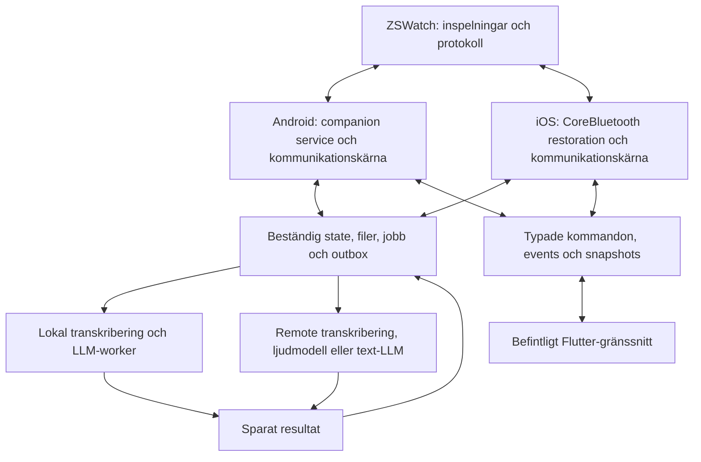

# Plan för ZSWatchApp: bakgrundsfunktioner och automatiska tester på riktig hårdvara

Datum: 2026-10-02. Status: **reviderat förslag efter review och användarens prioritering**. Dokumentet beskriver arbete som återstår; det innebär inte att bakgrundsfunktionerna eller testuppställningen redan är verifierade. [Reviewunderlaget](/home/jakkra/Documents/ZSWatchApp/COMPANION_BACKGROUND_PLAN_REVIEW.md) är inarbetat. Implementationsläget och senare hårdvarufynd beskrivs i avsnitt 13.

## 1. Rekommenderat beslut

Behåll Flutter för appens gränssnitt. Bygg en companion-kärna vars livscykel ägs av Android respektive iOS och som kan hantera anslutning, notificationer, tid, HTTP och mottagning av voice memos utan en öppen Flutter-vy. Separera lokal och remote AI från kommunikationskärnan med beständiga jobb och en beständig leveranskö till klockan.

Android är första genomförandeplattform eftersom den nuvarande Linux-datorn kan bygga appen, styra en fysisk Android-telefon och styra klockan. En tidig iOS-prototyp är samtidigt en beslutspunkt: iOS får inte skjutas upp tills en Android-lösning redan har definierat fel plattformsoberoende antaganden.

En Android-tjänst med en egen Flutter-engine är ett möjligt sätt att behålla mer Dart-kod. Utvärdera den endast i ett avgränsat experiment med samma acceptanstester som native-kärnan. Rekommenderad grund är native ägarskap av livscykel, kritisk kommunikation och säker filpersistens. Ingen fullständig omskrivning av gränssnittet planeras.

### Prioritering för genomförandet

Huvudfrågan är att få en självständig companion som fungerar med stängd appvy, återansluter och tar emot inspelningar säkert, samtidigt som befintligt Flutter-arbete och lokala modeller kan behållas. De tidiga prototyperna ska avgöra gränsen mellan Dart och native innan större portning eller DB-migrering låses.

Prova först normala användarflöden och vanlig bakgrundskörning på riktiga telefoner. Att processen avslutas just medan ett remote-jobb väntar behandlas som ett separat återhämtningsfall. Vanlig iOS-suspension under väntan ingår däremot i normal bakgrundskörning. Börja med ett litet fungerande recording→bearbetning→resultat-flöde; bygg ut avbrottståligheten stegvis. Inför inte en egen server eller ett omfattande push-system enbart för detta specialfall innan prototypen visar behovet.

HTTP finns kvar i funktionsomfattningen, men de identifierade timeout-/callback-felen är ett mindre, avgränsat arbetspaket. De ska åtgärdas och regressionstestas utan att fördröja experimenten med runtime-ägarskap, återanslutning och voice-flödet.

Aktuell styrning från användaren 2026-10-03: prioritera fungerande BLE och integration
med appen före mer edge-case-hårdning. Utredningen av transferkorruption är fortsatt
separat. Mer klock-/deadline-hårdning ska inte bli nästa huvudspår. Nokia används
för BLE/livscykel; AI-inferens och faktisk modell-/headless-worker-körning ska testas
senare på en lämplig nyare telefon. Kod för att återanvända Dart kan förberedas och
kompileras under tiden. Behåll både lokal och remote AI som val i arkitekturen.

Aktuell omprioritering från användaren: Androids gemensamma companion-funktioner
är huvudspåret, inklusive HTTP, notifikationer, tid, BLE-ägarskap och återhämtning.
Nokia används för alla icke-AI-funktioner som den kan verifiera. AI-integration,
modeller och fler recording-/processingförbättringar är nedprioriterade tills
kommunikationskärnan fungerar genom bakgrundskörning och avbrott. iOS-arbete
skjuts upp för närvarande. Behåll befintlig Flutter-UI och återanvänd befintliga
Nordic-/Dart-fixar; detta ändrar arbetsordningen, inte slutarkitekturens val av
lokal eller remote AI.

### Produktkrav

| Funktion | Avsedd användarupplevelse | Återhämtning vid avbrott |
| --- | --- | --- |
| Notificationer | Leverans till klockan med telefonen låst och appvyn stängd. | Återanslutning återställer forwarding. Definiera hantering av aktuella aktiva notifikationer; lova inte historik som OS aldrig levererat. |
| Tid | Rätt tid efter anslutning, tidsändring och tidszonsbyte. | Klockan fortsätter hålla tid själv; synka igen när länken återställs. |
| HTTP | Klockans request får svar, cache eller ett uttryckligt fel enligt protokollet. | Request-ID, deadline och säker retry-policy; ingen oändlig väntan. |
| Voice memos | Inspelningen sparas på klockan och hämtas utan att appvyn öppnas. | Klockans kopia behålls tills telefonens mottagning är varaktigt lagrad. |
| Remote AI | Sparat ljud eller text kan skickas till vald backend; resultat återkommer även efter avbrott. | Spara jobb-ID, input, backendval och resultat; försök igen när exekvering tillåts. |
| Lokal AI | Lokala modeller finns kvar som ett användarvalt alternativ. | Jobbet kan vänta eller börja om från sparad input. Omedelbar lokal inferens i alla iOS-bakgrundslägen är inget löfte. |

Målet är en fungerande companion utan återkommande handpåläggning, med återhämtning där OS tillåter den och utan tyst dataförlust. En process som aldrig dör, ständig nätåtkomst och omedelbar återstart i varje OS-läge är inte rimliga acceptanskrav, även för en helt native app.

## 2. Underlag och verifierad utgångspunkt

Planen bygger på:

- [Bakgrundsresearch](/home/jakkra/Documents/ZSWatchApp/BACKGROUND_RELIABILITY_RESEARCH.md).
- [Gadgetbridge och voice-pipeline](/home/jakkra/Documents/ZSWatchApp/GADGETBRIDGE_AND_VOICE_PIPELINE_RESEARCH.md).
- [AI Agent Testing Guide](/home/jakkra/Documents/ZSWatch/.github/instructions/agent-testing.instructions.md).
- [Firmwaretesternas README](/home/jakkra/Documents/ZSWatch/app/pytest/README.md).
- [Watch Tools](/home/jakkra/Documents/ZSWatch/website/src/components/WatchTools/README.md) och [användarguiden](/home/jakkra/Documents/ZSWatch/website/docs/getting-started/watch-tools.md).
- [Bygginstruktioner](/home/jakkra/Documents/ZSWatch/website/docs/development/compiling.md) och [debuginstruktioner](/home/jakkra/Documents/ZSWatch/website/docs/development/debugging.md).

### Gap i appen som ska åtgärdas

| Nuvarande kod | Gap | Planerad ändring |
| --- | --- | --- |
| `BleConnectionForegroundService.kt` | Foreground-status finns, men tjänsten äger inte fungerande BLE och startar inte en egen Dart-runtime. | Tjänsten startar/återskapar den verkliga companion-kärnan. |
| `BootReceiver.kt` och sticky service-start | Återstart kan visa reconnecting utan att kommunikation återställs. | Läs beständigt reconnect-val, rekonstruera transport och handlers; hantera null-intent. |
| `MainActivity.kt` och NotificationListener | Viktiga callbacks är kopplade till Activity-livscykeln. | NotificationListener kommunicerar med kärnan oberoende av Activity. |
| `lib/app.dart` | BLE och handlers initieras från UI-start. | Kritiska handlers startas från native bakgrundsstart; Flutter ansluter som klient. |
| iOS Bluetooth-start | Background mode finns, men restoration är inte aktiverad i appens FlutterBluePlus-anrop. | Tidig manager-init, stabil restoration-identitet och adoption av återställda peripherals. |
| MCUmgr-wrapper på iOS | Skapar separat central manager vid pluginregistrering. | Samordna med ASK-start och transporternas livscykel. |
| `VoiceMemoSyncService` | Filcommit, DB och radering beror på Dart-callback efter slutförd native download. | Native mottagning till staging-fil, verifiering och beständigt mottagningsjobb. |
| `VoiceNoteAiPipeline` och resultatsändning | Lokal implementation och direktsändning; inte en full beständig remote-jobb/outbox-kedja. | Backendgränssnitt, sparade faser, recovery och kvitterad resultatleverans. |
| BLE-abstraktionen | FlutterBluePlus-typer läcker in i appens gränssnitt. | Plattformneutrala kommandon, händelser och snapshots. |

Detaljer och filreferenser finns i researchdokumenten. Befintliga inspelningar, modeller, användarinställningar och Flutter-skärmar ska bevaras vid migrering.

### Dator och hårdvara kontrollerad 2026-10-02

| Resurs | Observerat läge | Vad det betyder |
| --- | --- | --- |
| Linux-dator | `adb`, Flutter, BlueZ, west, nrfutil och J-Link-verktyg finns. | Android och firmware kan utvecklas här. |
| Bluetooth | Adapter `D8:B3:2F:44:B7:BC`; en kort discovery lyckades. | PC kan användas för separata BLE-protokolltester. |
| Android | `adb devices -l` och mDNS-listan var tomma. | Ingen telefon är ännu åtkomlig för appens end-to-end-tester. |
| Watch debug | J-Link PLUS och FTDI finns på USB. | Närvaro av debugger är verifierad; kontakt med rätt målkrets är ännu inte verifierad i detta steg. |
| UART | `/dev/serial/by-id/usb-FTDI_FT232R_USB_UART_BG00RS5E-if00-port0`, 115200 baud. Inga bytes under fyra sekunders avläsning. | Porten finns; rätt inkoppling och aktuell firmware/loggkonfiguration behöver kontrolleras. |
| Watch USB CDC | Ingen ZSWatch CDC-port observerades. | Den befintliga USB-SMP-styrningen kan inte antas fungera just nu. |
| Watch BLE | Två ZSWatch-poster finns i BlueZ-cache, men ingen syntes i den korta skanningen. | Cacheposter är inte bevis för vilken klocka som är aktiv eller för en fungerande länk. |
| iOS | Ingen Mac/Xcode-miljö är tillgänglig i denna uppställning. | En åtkomlig Mac och fysisk iPhone krävs för att verifiera iOS-delen. |

Detta är inventering, inte en godkänd hårdvarutestserie. Äldre lyckade Watch Tools-körningar och pairing-observationer i repot är referenser; nya ändringar ska testas på nytt.

## 3. Arkitektur och ansvar



Android och iOS är alternativa implementationer på respektive telefon, inte samtidiga anslutningar till samma klocka.

### Companion-kärnan äger

- Klockidentitet, användarens connect/disconnect-val och återanslutning.
- GATT discovery, subscriptions, framing, chunking, MTU och serialiserade writes.
- Anslutningstillstånd med generation/session-ID så sena callbacks från en gammal session ignoreras.
- Kritiska watch-requests, notificationer, tid och HTTP-executor.
- Filhämtning, verifierad mottagning och recovery efter avbrott.
- Beständig arbetskö och leveranskö; arbetets CPU-exekvering kan ske i separat worker.
- Avtal med MCUmgr/DFU om exklusiva operationer och återställning av vanlig kommunikation efteråt.

Flutter visar kärnans state och skickar kommandon. UI-start får inte öppna en andra anslutning eller återställa tillståndet till disconnected innan en snapshot lästs. Core-ready, transport-connected och protocol-ready är olika tillstånd.

### Gränssnitt som ska definieras först

Exempel på kontrakt, inte färdig API:

- Kommandon: `connect`, `disconnect`, `getSnapshot`, `syncRecordings`, `retryJob`, `selectBackend`, `cancelJob`.
- Händelser: connection state, behörighetsfel, mottagen recording, jobbförändring, watch-resultat kvitterat.
- Snapshot: vald klocka, reconnect-policy, transport/protokollstatus, senaste kontakt och alla väntande jobb.
- Händelser kan komma innan Flutter finns. Sparade jobb läses via snapshot; viktiga data får inte endast ligga i en EventChannel.
- Samma semantik och delade protokollfixtures på Kotlin, Swift och Dart; implementera inte tre konkurrerande definitioner av vad ett ACK betyder.

### Lagring och migrering

Companion-kärnan ska ha en tydligt utsedd ägare av schema och migrationer. Rekommenderad utgångspunkt är en core-store som ägs av native-kärnan och nås från Flutter via bryggan. Befintlig Flutter-DB migreras eller speglas kontrollerat för relevanta voice-memo-data.

Detta är en målbild om native-kärnan väljs. Prototypen behöver bara den minsta beständiga state som krävs för att bevisa mottagning och recovery. Om den service-ägda Dart-lösningen klarar kraven kan mer av befintlig lagring behållas; en bred schema-/repository-migrering ska inte vara inträdeskrav till experimentet.

Två oberoende ORM/migrationssystem får inte ändra samma SQLite-schema vid appstart. Om befintlig DB återanvänds krävs en gemensam schemaauktoritet och kompatibilitetstest för båda runtimes. Filcommit och databascommit är inte en atomär transaktion tillsammans; en recovery-pass måste hantera avbrott mellan dem.

Registrera minst watch-ID, recording-ID, filversion/hash, backendval, fas, försök, senaste fel, nästa tillåtna försök, remote-jobb-ID och result/outbox-ID. Använd leases för pågående jobb så en tidigare process inte lämnar dem permanent upptagna. Spara deadlines som tidsvärden; rekonstruera timers efter start.

Kontrollera även åtkomst när telefonen är låst: DB, staging/permanent ljudfil, bakgrunds-uploadfil och credentials måste ha ett medvetet skydd som passar den valda bakgrundsfunktionen. På iOS utvärderas lämplig file protection och Keychain-accessibility, inklusive före/efter första unlock. Låsning ska ge definierad väntan om data är otillgänglig, inte radering eller ett falskt success. [Keychain-accessibility för bakgrundsappar](https://developer.apple.com/documentation/security/ksecattraccessibleafterfirstunlockthisdeviceonly).

## 4. Android-genomförande

1. Gör companion-tjänsten till ägare av en fungerande runtime, oberoende av `MainActivity`.
2. Rekonstruera connect-intent och handlers på sticky/null-intent-start, boot och paketuppdatering där start tillåts. Explicit disconnect måste bestå efter omstart.
3. Inför `CompanionDeviceManager`-association och `CompanionDeviceService`/presence där det stöds. Kontrollera den verkliga klockans adressbeteende och bonding innan detta väljs som enda recovery-väg.
4. Behåll korrekt `connectedDevice` foreground service där det behövs, med startregler och behörigheter för de stödda Android-versionerna.
5. Koppla NotificationListener och tids-/tidszonshändelser direkt till kärnan. Förhindra dubbelleverans när UI återansluter.
6. Utför HTTP utanför GATT-callbacktråden. Inför begränsad concurrency och backpressure så filhämtning och notificationer inte svälter varandra.
7. Lägg lokal AI i en separat worker/runtime. Ladda inga modeller vid vanlig BLE-recovery. Uppmätt behov får avgöra om en separat Android-process senare motiveras.
8. Verifiera separat att den valda companion-konfigurationen ger den nätåtkomst som behövs under Doze. Registrera association, relevanta companion-/databehörigheter och faktisk power-exemption. Välj fallback utifrån resultatet; anta varken att en levande FGS räcker eller att manuellt batteriundantag alltid behövs.

Androids officiella vägledning beskriver companion-presence/service och `connectedDevice` FGS för långvarig periferilyssning. Den anger också att GATT stängs vid processdöd och att CDM har adressbegränsningar. [BLE i bakgrunden](https://developer.android.com/develop/connectivity/bluetooth/ble/background).

Lång AI-bearbetning ska inte gömmas som obegränsat arbete i anslutningstjänsten. Välj worker/service-typ efter faktisk uppgift och OS-regler. Android 16 kan begränsa även långvariga WorkManager-jobb genom job quotas. [Service-typer](https://developer.android.com/develop/background-work/services/fgs/service-types), [långvariga workers](https://developer.android.com/develop/background-work/background-tasks/persistent/how-to/long-running).

Nätåtkomst är relevant för både HTTP och remote AI. Testa med snabb kontrollerad server och verifierat Doze-state. Ett kontrollerat timeout-/pending-svar visar fungerande felhantering, men får inte godkänna ett krav på färskt nätresultat. Cache och fördröjt arbete får egna uttryckliga produktkrav. [Android om Doze och nätåtkomst](https://developer.android.com/training/monitoring-device-state/doze-standby).

### Avgränsat experiment med service-ägd Flutter-engine

Tillåt högst två till tre fokuserade utvecklingsdagar som initial experimentbudget, justerbar efter första mätning. Starta en root Dart-runtime från tjänsten, flytta Activity-beroende bridges och verifiera alla fyra kritiska funktioner efter UI-destruktion och process-restart. Pluginstöd, minne, eventförlust och dubbla ägare ska mätas.

Behåll lösningen endast om den klarar samma end-to-end-grind som native-alternativet. En levande foreground-notifikation eller fungerande scan räcker inte. Om viktiga plugins kräver Activity eller startfördröjningen tappar watch-events: avsluta experimentet och flytta kritiska handlers native bakom det redan definierade kontraktet.

## 5. iOS-genomförande

1. Skapa en åtkomlig Mac/iPhone-testuppställning före iOS-acceptans. Behåll nuvarande iOS 14-minimum tills ett uttryckligt produktbeslut fattas; ASK används med availability-checks.
2. Prova explicit FlutterBluePlus-restoration som diagnostiskt steg. Lägg till adoption av återställd anslutning så normal connect-logik inte först disconnectar den.
3. Inför tidig native manager-start med stabil restoration-identitet, delegate och buffring/persistens innan Flutter finns. Native kärna rekommenderas för kritiska callbacks.
4. Inför AccessorySetupKit för stödda system och ett migreringsflöde för redan parkopplade klockor. Samordna **alla** central managers, även MCUmgr, med migrationen.
5. Kontrollera att klockans annonsering, inklusive UUID i scan response, kan upptäckas och matchas av ASK. Ändra annonsering endast om den faktiska prototypen visar behov.
6. Prova kort HTTP-exekvering och inspelningsmottagning vid legitim BLE-wakeup. Mät vilka recording-längder som fungerar under låst telefon och efter restoration.
7. Använd bakgrunds-URLSession för större remote upload/download-steg, med filbaserad upload, stabil sessionsidentitet och återkoppling till sparat jobb.
8. Behåll watch-firmwareflödet via ANCS för iPhone-notifikationer och AMS för media. En iOS-app får inte antas ha Androids generella NotificationListener-funktion.
9. Testa vanlig systemtermination, user force-quit och reboot/första unlock som separata fall. Exakt vilka fall som stöds dokumenteras per OS-version och ASK-konfiguration.
10. Prova tidigt hela voice-flödet med en enkel remote-fixture: mottagning → bearbetning → resultat på klockan med låst telefon. Låt även servern bli klar efter vanlig suspension. Separera därefter testet där processen avslutas mitt i väntan; bevara jobbet och dokumentera vilken händelse som driver recovery enligt avsnitt 7.

Apple beskriver eventbaserad Bluetooth-restoration. TN3115 har en iOS 26-regel för ASK-konfigurerade accessories i vissa relaunch-fall, inklusive user force-quit; relaunch kräver en väntande Bluetooth-operation och motsvarande event. Det är ingen allmän rätt till kontinuerlig CPU-exekvering. [TN3115](https://developer.apple.com/documentation/technotes/tn3115-bluetooth-state-restoration-app-relaunch-rules), [ASK setup/migration](https://developer.apple.com/documentation/AccessorySetupKit/discovering-and-configuring-accessories).

OS-hanterad nätöverföring och BLE-filöverföring är olika mekanismer. Bakgrunds-URLSession kan köras i en separat OS-process och återkopplas efter relaunch, men kan schemaläggas med fördröjning och har egna force-quit-regler. [Bakgrundsöverföringar](https://developer.apple.com/documentation/foundation/downloading-files-in-the-background), [cancellation reasons](https://developer.apple.com/documentation/foundation/url-session-background-task-cancellation-reasons).

På iOS får lokal inference som startas av klockan kunna vänta. Utvärdera separat foreground-startad `BGContinuedProcessingTask` på iOS 26; använd den inte som antagande för godtycklig watch-startad bakgrundsinferens. [Continued processing](https://developer.apple.com/documentation/backgroundtasks/bgcontinuedprocessingtask).

## 6. HTTP, notificationer och tid

### HTTP

- Bevara det befintliga request/response-kontraktet, inklusive request-ID och XPath där det används. Dokumentera faktiskt nuvarande format före native-portning.
- Inför deadline, max svarsstorlek, samtidighetsgräns och definierade nät-/parsefel. Håll credentials och payloads borta från diagnostikloggar.
- Använd cache med ålder där funktionen tillåter det. HTTP som måste vara omedelbart ska testas som omedelbart; lång OS-schemalagd download är inte en ersättning.
- För längre arbete: använd pending/result-protokoll endast om klockan stöder det. Annars behövs versionsförhandlad firmwareändring eller det korrigerade timeout/error-kontraktet nedan.
- Gör inte automatisk replay av en godtycklig HTTP-request med sidoeffekter. Retry av POST/liknande kräver backend-idempotens eller uttrycklig policy. GET-cache och omförsök behandlas separat.

**Mindre arbetspaket — HTTP-slutkontrakt:** reviewn fann 10 sekunders timeout i [klockan](/home/jakkra/Documents/ZSWatch/app/src/ble/ble_http.c:14) och 30 sekunder i [appen](/home/jakkra/Documents/ZSWatchApp/zswatch_app/lib/services/http/http_relay_service.dart:41). Klockans `err`-väg stoppar timeouten utan terminal callback; sena svar kan samtidigt behandlas efter timeout. Samordna deadline med marginal för transport och ge varje accepterad request exakt ett slutresultat. Felsvar/tomt svar ska avsluta requesten, och sena/dubbla svar ska ignoreras efter avslut. Bevara kompatibelt wire-format. Testa normal framgång, fel före timeout och svar efter timeout mot den verkliga watch-konsumenten. Detta är en avgränsad fix som kan genomföras vid sidan av kärnprototypen.

### Notificationer

- Android: capture, filtrering och forwarding ska fungera utan Activity. ID, update och remove ska behålla semantik och undvika dubbletter.
- iOS: verifiera ANCS på hårdvaran när appen är suspenderad/terminerad och när länken återställs.
- Använd en egen testnotifierare med kända ID:n och innehåll. Kontrollera mottagning på klockan; loggen “sending” på telefonen är inte slutbevis.
- Lagra inte all privat notifikationstext för replay. Definiera en kortlivad policy för aktiva notificationer och deduplicering.

### Tid

- Synka vid protocol-ready/reconnect och vid relevanta systemändringar. Skicka UTC/tidszon enligt det befintliga firmwarekontraktet, inklusive DST.
- Kontrollera klockans faktiskt lagrade/visade tid, inte endast att ett paket skickats.
- Testa tidszonsbyten med kontrollerad fixture/debugkälla där möjligt; verkliga ändringar av telefonens systemtid görs på testtelefon.
- Drift utan telefon mäts separat; den nuvarande RTC-konfigurationen dokumenteras per firmwarebuild.

## 7. Voice memos och AI: beständig kedja

### Tillstånd som ska kunna återställas

```text
watch_saved → discovered → downloading → phone_file_committed
            → receipt_committed → processing_pending → processing
            → result_committed → delivery_pending → delivery_acked

watch_delete_pending → watch_delete_confirmed
```

Watch-delete är ett separat tillstånd från AI-resultat och watch-leverans. Avbruten överföring får starta om från början om biblioteket saknar verifierad offset-resume. Det är bättre än att kalla en overifierad fortsättning för resume.

### Mottagning

1. Hämta metadata via befintligt NUS-protokoll och ljud via Nordic MCUmgr från `/user/recordings/`.
2. Använd stabil kombination av watch-ID och recording-ID. Om firmware saknar stabil identitet: definiera den och förhandla stöd; filename/timestamp räcker inte utan analys av återanvändning och reset.
3. Skriv till staging-fil, verifiera header, storlek och Opus-framegränser; hash kan användas för integritet/deduplicering.
4. Flush/commit och flytta till permanent plats på samma filsystem där det är möjligt. Registrera mottagning och väntande AI-jobb beständigt.
5. Först därefter får telefonen begära radering. Kontrollera kvittens eller verifiera frånvaro genom ny listning. Ett skickat delete-paket betyder inte att raderingen lyckades.
6. Vid start: reconcile staging-filer, committade filer utan DB-rad, DB-rader utan fil och watch-inspelningar som redan tagits emot. Behåll den säkra kopian vid osäkerhet.

Överföringen ska använda den native MCUmgr-kod som redan finns bakom wrappern. Android och iOS ska samordna SMP, vanlig trafik och DFU; flera bibliotek kan ha olika transportobjekt utan att de blir oberoende ägare av användarens anslutningsstate.

Använd Nordics befintliga transport och protokollhantering: Androids
`mcumgr-ble` och iOS `iOSMcuManagerLibrary`. Implementera inte egen SMP-sekvensering,
fragmentering eller svarskorrelation. En tjänst som samordnar livscykeln får äga
flera biblioteksstyrda transportobjekt; en enda logisk companion-ägare betyder
inte att NUS och MCUmgr måste dela samma `BluetoothGatt`-objekt. Förändringar ska
gälla start, avbrott, recovery och persistens runt bibliotekens API:er.

### Backendval

Definiera separata `TranscriptionBackend` och `VoiceAnalysisBackend`, plus möjlighet till en backend som analyserar ljud direkt. Stöd minst:

| Val | Ljud → text | Text/ljud → resultat |
| --- | --- | --- |
| Helt lokalt | Lokal Whisper/annan befintlig STT | Lokal befintlig LLM |
| Hybrid | Lokal STT | Remote text-LLM |
| Remote | Remote STT eller ljudmodell | Remote analys, eventuellt samma request/jobb |

En remote text-LLM gör inte lokal Whisper snabbare. Bevara ursprungligt ljud för omkörning och jämförelse. Automatisk lokal/remote fallback ska följa ett uttryckligt användarval; offline får inte automatiskt bytas till uppladdning.

### Remote körning

- Börja med ett deterministiskt lokalt mock-jobb-API för tester. Använd en verklig vald leverantör i en separat integrationstestgrupp.
- Föredra submit/status/result med sparat remote-jobb-ID när backend erbjuder det. Vid behov utvärderas ett litet eget jobb-API, men det ska vara ett separat omfattningsbeslut.
- Använd idempotency key där stöd finns. Avbrott efter serveraccept men före lokal commit måste kunna återförenas med samma jobb; saknas stödet dokumenteras dubblettrisk och mitigering.
- Spara accepterat jobb, resultat och watch-outbox innan en transient callback avslutas. Definiera dessutom vad som driver nästa fas; beständig lagring ger inte i sig ny exekveringstid.
- Behandla credentials, retention, uploadsamtycke, cancellation och cleanup konkret för vald backend. Ingen riktig uppladdning behövs för den lokala recovery-testsviten.

### Framdrift och återhämtning under väntan

Använd först befintliga plattformsmekanismer och en enkel backend. Följande ansvar ska finnas även om implementationen till en början är liten:

| Väntande fas | Vad driver arbetet vidare? | Vid avbrott |
| --- | --- | --- |
| Upload | Aktiv överföring eller OS-hanterad transfer med completion-callback. | Återskapa session/koppling till jobbet; återuppta eller försök om från sparad fil. |
| Serverbearbetning | Backendens normala svar medan appen kör; för asynkront jobb används ett uttryckligt resultatflöde. | Spara jobb-ID och nästa försök. Kör statuskontroll vid nästa tillåtna trigger. |
| Resultat väntar på hämtning | Välj i prototypen mellan tillgänglig servernotifiering, relevant OS-callback och riktiga resultatförfrågningar från klockan för ett känt väntande jobb. | Prova utebliven notifiering och återuppta vid nästa definierade trigger. |
| Sparad watch-outbox | När kärnan kan exekvera och länken är protocol-ready; även vid reconnect/resultatförfrågan. | Replay med resultat-ID tills kvittens, utan dubbla actions. |

Om klockan ska efterfråga resultat för ett väntande jobb behövs ett avgränsat protokoll med backoff, slutvillkor och batteribudget. Det får inte bli en generell heartbeat för att hålla appen vid liv. Foreground-start och nästa verkliga watch-event är alltid tillfällen för reconciliation, men är inte ensamma tillräckligt bevis för automatisk leverans i normalfallet.

På iOS kan en tyst, redan ansluten klocka och ett sparat serverjobb lämna appen utan en ny trigger. Silent push kan hjälpa men har inte garanterad leverans. [Apple om background push](https://developer.apple.com/documentation/usernotifications/pushing-background-updates-to-your-app). Prototypen ska därför visa vilken väg som fungerar med vald backend under vanlig bakgrundskörning. Om det särskilda processavbrottsfallet kräver längre väntan ska det behålla data och visa ett korrekt vänteläge, med dokumenterad recovery-trigger; fördröjningen får inte döljas som färdig leverans. Mät beteendet innan en mer omfattande server-/push-arkitektur väljs.

### Lokal körning och externa actions

- Workers läser sparad input. Begränsa samtidighet och mät minne, temperatur och påverkan på BLE medan modeller används.
- Jobb kan omköras efter processdöd; checkpointad modellinferens är inget initialt krav.
- Spara resultat innan watch-leverans. Result-ID och idempotens behövs även för kalender/reminder-actions.
- Automatisk action får inte uppstå enbart därför att en in-memory confirmation-timer gick ut när klockan var frånkopplad. Spara confirmation/deadline/policy och definiera vad frånkoppling betyder.
- Exakt en extern action kan bara garanteras om action-mottagaren eller integrationslagret ger tillräcklig idempotens/reconciliation. Testa särskilt “action utförd, lokal kvittens förlorad”.

## 8. Gadgetbridge som Android-referens

Granskad upstream: `6cda126b7ec89838a1ded6309de96991c702b864` från 2026-10-01. Lokal äldre klon finns i `/home/jakkra/Documents/ZSWatchApp/Gadgetbridge`; aktuell researchklon i `/tmp/zswatch-gadgetbridge-research-20261002` är temporär och ska inte vara enda långsiktiga referensen.

Återanvänd design och beteenden från `DeviceCommunicationService`, `GBCompanionDeviceService`, `NotificationListener`, `BtLEQueue`, `TimeChangeReceiver` och Bangle.js HTTP/protokoll. Zepp voice-memo-kod är endast en referens för tjänsteägd hämtning; protokollet är annorlunda.

Gadgetbridge är inte en färdig importerbar ZSWatch-runtime och dess minnesköer ersätter inte vår beständiga AI-kedja. Klasserna har stora beroenden till Gadgetbridge-applikationen. Föredra en fokuserad ZSWatch-implementation; eventuell avgränsad kodextraktion bedöms separat.

Direkt kopiering kräver ett beslutat licensupplägg eftersom Gadgetbridge anger AGPL-3.0-or-later och ZSWatchApp anger MIT. Planen förutsätter ingen kodkopiering. [Detaljer och låsta källlänkar](/home/jakkra/Documents/ZSWatchApp/GADGETBRIDGE_AND_VOICE_PIPELINE_RESEARCH.md).

## 9. Testuppställning för självständigt arbete

### Engångsuppgifter med fysisk medverkan

1. Anslut en Android-testtelefon med datakabel. Aktivera utvecklaralternativ och USB-debugging och godkänn datorns RSA-nyckel på telefonen. Detta godkännande kan inte göras från en ännu obehörig ADB-anslutning.
2. Aktivera nödvändiga appbehörigheter och notification access på testtelefonen. Automatisera kommande UI-flöden där systemet tillåter det; första association/OS-dialog dokumenteras som setup.
3. Anslut rätt klocka till ström, SWD och den logg-/styrport som ska användas. Kontrollera UART Tx/GND och USB CDC. Identifiera den faktiska J-Link-serien och klockans board-revision.
4. Parkoppla telefon och klocka via appens produktflöde. En separat PC-bond är endast nödvändig för fristående PC-BLE-tester.
5. För iOS: gör en Mac åtkomlig för bygg-/testkommandon, installera Xcode, konfigurera signing, anslut en fysisk iPhone, aktivera Developer Mode och godkänn datorn. Kontobundna signing/trust-steg kan kräva fysisk medverkan igen vid byte eller återkallat förtroende.

Efter setup ska agenten kunna bygga, installera, starta, styra, samla bevis och upprepa tester utan att användaren manuellt provar varje ändring. Kablar som lossnar, telefonens första unlock efter reboot och vissa säkerhetsdialoger kan fortfarande kräva fysisk hjälp. Ett test som stoppas av detta rapporteras som blockerat/ej kört, aldrig som PASS.

[ADB setup](https://developer.android.com/tools/adb), [fysiska Apple-enheter](https://developer.apple.com/documentation/xcode/running-your-app-on-simulated-or-physical-devices).

### Två separata styrvägar

```text
Dator ── ADB / UI Automator ── Android-telefon ── riktig BLE ── Klocka
      └─ USB-SMP / debugstyrning + UART/RTT-loggar ────────────┘
```

Telefonen ska vara BLE-central i appens end-to-end-tester. Datorn styr klockan via en annan väg så att testet inte behöver ta över telefonens BLE-session. UART-loggar och USB-SMP-kommandon kan ha separata portar; FTDI-loggporten är inte automatiskt en text-shell eller SMP-port.

Om USB CDC inte kan återställas: utvärdera en debug-only serial/RTT-commandkanal med motsvarande funktioner. Anta inte att befintlig RTT-logging är en fungerande RTT-shell. Styrning av klockan får inte bero på samma BLE-länk som testet ska bryta.

PC-BLE-tester med BlueZ/Bleak används separat för advertising, bonding, framing och protokoll. Koppla från PC/Watch Tools innan telefonens tester om klockan bara tillåter en central. Ett PASS från PC ersätter aldrig Android-/iOS-bakgrundsacceptans.

### Utrustning och fixtures

- Börja med en fysisk Android-telefon; bredda senare till minst en annan tillverkare med annan batterihantering.
- En fysisk iPhone på iOS 26+ för ASK-spåret och en äldre stödd iOS-version för fallback där tillgängligt.
- Klocka med verifierad revision, firmware och stabil styrkanal.
- Deterministisk HTTP-server och mock remote-jobbserver på datorn. På Android kan `adb reverse` användas för USB-tester; långtidsprov över Wi-Fi måste använda en verkligt nåbar adress eftersom USB-tunneln försvinner vid urkoppling.
- Egen notification-fixtureapp. Använd inte privata inkommande meddelanden som testdata.
- Kända svenska/engelska ljudklipp för STT. Testa både befintliga filer och uppspelning via datorns högtalare till klockans verkliga mikrofon.
- PPK2 är valfritt för klockans strömmätning; dess aktuella tillgänglighet är inte verifierad. Telefonens batteri/CPU/minne mäts med respektive plattformsverktyg.

## 10. Operativ körguide för agenten

Kommandona nedan är instruktioner för senare genomförande. De har inte körts som en ny bygg-/flash-/telefontestserie när denna plan skrevs. Sökvägar är anpassade till den nuvarande checkouten i `/home/jakkra/Documents/ZSWatch`.

### 10.1 Inventera och lås rätt enheter

Den första Linux/Android-grunden finns nu i `scripts/companion_hil/hil.py`.
Körbar setup, preflight, collectors och session-probe dokumenteras i
[`scripts/companion_hil/README.md`](scripts/companion_hil/README.md). Den inventerar
och samlar loggar; den kör ännu inte funktionernas end-to-end-acceptans.

```bash
adb devices -l
adb mdns services
lsusb
ls -l /dev/serial/by-id
bluetoothctl list
```

Registrera telefonserien som `ZSW_PHONE_SERIAL`, verifierad debugger som `ZSW_JLINK_SERIAL`, UART som `ZSW_UART_PORT` och USB-SMP-port som `ZSW_SMP_PORT`. Rikta alltid senare kommandon mot rätt serienummer. Läs J-Link-identiteten med verktygets read-only device list; använd inte gamla nummer från tidigare audit eller `devices.yaml`.

Firmware-pytest stöder nu `--device-config /absolut/sökväg/devices_local.yaml`
och den befintliga lokala overriden. Ange `--board` explicit; okänd matchning
avvisas. `app/pytest/devices.yaml` innehåller äldre port-/MAC-/debuggeruppgifter.
Välj verifierad utrustning i lokal config och ändra inte den delade definitionen.

Spara preflight: repo-revisioner och dirty diff, telefonmodell/OS, klockrevision, bond/association-status, firmwareversion, firmwarehash, appversion och APK-hash. Arbetskatalogerna har redan lokala ändringar; bevara dem och dokumentera vad som faktiskt byggdes. Ändringar i två repos spåras separat.

### 10.2 Bygg och installera Android-appen

```bash
cd /home/jakkra/Documents/ZSWatchApp/zswatch_app
flutter pub get
flutter build apk --release
adb -s "$ZSW_PHONE_SERIAL" install -r build/app/outputs/flutter-apk/app-release.apk
adb -s "$ZSW_PHONE_SERIAL" shell am start -n com.zswatch.app/dev.zswatch.app.MainActivity
```

Aktuell `applicationId` är **`com.zswatch.app`**; Kotlin namespace är `dev.zswatch.app`. Kontrollera installerad package/activity vid framtida flavor-ändring. Vid signatureskillnad: utred signing och backup/migrering, avinstallera inte rutinmässigt appen med användardata. Ett separat testpaket kräver motsvarande konfiguration av listeners, associations och testsignering.

Använd release eller en release-lik diagnostikvariant för livscykelacceptans. Debug/hot reload används för snabb utveckling men är inte enda beviset för bakgrundsbeteende.

```bash
adb -s "$ZSW_PHONE_SERIAL" shell getprop ro.build.version.release
adb -s "$ZSW_PHONE_SERIAL" shell getprop ro.build.version.sdk
adb -s "$ZSW_PHONE_SERIAL" shell dumpsys activity services com.zswatch.app
adb -s "$ZSW_PHONE_SERIAL" shell dumpsys package com.zswatch.app
adb -s "$ZSW_PHONE_SERIAL" logcat -v epoch
```

Logcat filtreras/sparas av harness efter relevant tag/UID utan att oavsiktligt missa systemets service-/exitförklaring. Skärmbild tas med `adb exec-out screencap -p`; UI Automator används för system- och appkontroller med waits på faktiskt tillstånd. [UI Automator](https://developer.android.com/training/testing/other-components/ui-automator).

### 10.3 Bygg firmware för debug med produktens pairing-skydd

```bash
cd /home/jakkra/Documents/ZSWatch
source .nrf_env.sh
west build --build-dir app/build_companion_hil app \
  --board watchdk@1/nrf5340/cpuapp -- \
  -DEXTRA_CONF_FILE="boards/debug.conf;boards/log_on_uart.conf" \
  -DEXTRA_DTC_OVERLAY_FILE="boards/log_on_uart.overlay" \
  -DCONFIG_BLE_DISABLE_PAIRING_REQUIRED=n
```

Använd detta board-val endast efter verifiering att den anslutna enheten är WatchDK revision 1. För annan hårdvara används motsvarande board-definition. Gör en pristine rebuild om Kconfig/overlay/board har ändrats på ett sätt som den befintliga buildkatalogen inte representerar.

**Viktigt:** både `debug.conf` och native-simulatorns standardkonfiguration kan stänga av kravet på pairing. Det explicita `n` ovan behövs för realistiska companion-/pairingtester. Kontrollera genererad `.config`, inte bara argumentlistan:

```bash
rg -n 'BLE_DISABLE_PAIRING_REQUIRED|BT_SMP|SHELL_BACKEND|MCUMGR_GRP_SHELL|LOG_BACKEND' \
  app/build_companion_hil/app/zephyr/.config
```

För RTT istället för UART: byt loggfragmentet till `boards/log_on_rtt.conf` och utelämna UART-overlay. Test-mode-fragment kan läggas till för att hoppa över onboarding i isolerade tester; kör även normal onboarding och release-konfiguration. Den nuvarande `test_mode.conf` sätter skip-onboarding/loggnivåer; den äldre agentguidens exempel med `CONFIG_ZSW_TEST_MODE` beskriver inte aktuell Kconfig.

### 10.4 Flashning och exakt buildproveniens

1. Hämta befintlig kraschrapport och relevanta testinspelningar innan flashning som kan ändra flash/layout.
2. Arkivera ny build: ELF, `.config`, devicetree/partition map, images/DFU-zip, buildlogg, revision + diff och checksummor.
3. Kontrollera den genererade runner-konfigurationen, tillgängligt CLI och rätt debugger. Kör exempelvis följande efter preflight:

```bash
west flash --build-dir app/build_companion_hil --dev-id "$ZSW_JLINK_SERIAL"
```

4. Verifiera bootversion, radio, filsystem och pairingkonfiguration från faktisk enhet.
5. Vid flashfel: samla fel och undersök mål/runner innan recovery. Kör inte automatiskt recover, factory reset eller generell erase som fallback. De kan förstöra state som testet ska bevara.

`.agent_tools/flash_and_log.py` saknar explicit debugger-val och kan resetta/flash utan tillräcklig buildproveniens. Använd den inte oförändrad i en uppställning med flera enheter. Bygg en riktad wrapper eller använd west med explicit enhetsval.

### 10.5 Samla firmwareloggar

UART-hjälpen finns redan och kan användas för en kort, fristående capture:

```bash
python3 /home/jakkra/Documents/ZSWatch/.agent_tools/serial_capture.py \
  --port "$ZSW_UART_PORT" --baud 115200 --seconds 30 \
  > /tmp/zswatch-uart.log
```

I automatiska tester används en långlivad collector med tidsstämplar som öppnas **före** åtgärden. Endast en process läser respektive seriell port; fördela sedan den sparade strömmen till olika assertions. “Inga loggar” får inte bli PASS för “inga krascher”.

RTT kan användas med SEGGER/Nordic-verktyg och rätt app-core/build. Kör inte samtidiga konkurrerande J-Link-sessioner för logging, flash och debugger utan verifierat stöd. Serial/RTT är förstahandsbevis när BLE avsiktligt bryts.

### 10.6 Styra klockan genom befintlig shell

Följande kommandon är verifierade i källkoden. Skicka dem via fungerande **USB-SMP shell**, inte som godtycklig text till FTDI-loggporten:

| Kommando | Användning |
| --- | --- |
| `app list` | Läs faktiska appnamn. |
| `app state` | Kontrollera watchface/app-manager och aktuell app. |
| `app launch Settings` | Öppna settings från watchface. |
| `app close` | Stäng aktuell app. |
| `touch X Y` | Tap med displaykoordinater. |
| `touchdown X Y`, `touchmove X Y`, `touchup` | Press/drag/release. |
| `power status`, `power wake` | Läs power state respektive väck displayen. |
| `battery` | Läs batteri-/laddstatus. |
| `voice_memo status`, `voice_memo list` | Läs inspelningsstate och filer. |
| `voice_memo start`, `voice_memo stop` | Gör riktig mikrofoninspelning; stop triggar det vanliga recordingflödet. |
| `coredump summary`, `coredump log` | Läs sparad krasch och skriv dump till loggtransporten. |

Återanvänd `shell_command_usb` och `with_serial_client` i [mcumgr_utils.py](/home/jakkra/Documents/ZSWatch/app/pytest/mcumgr_utils.py). Kommandon returnerar svar och ska kontrolleras; vänta sedan på respektive state/event istället för enbart fasta sleeps. Vid automatiserad pairing ska Settings → Bluetooth → Pairable styras genom det verkliga UI-flödet eller en motsvarande tydligt definierad debug-hook. Hårdkodade touchkoordinater ska versionskopplas till UI.

**HIL-fixtures måste anpassas innan denna guide används för companion-långtidstester:**

- `prepare_device` kan recover/flash automatiskt när `--skip-flash` saknas.
- `--skip-flash` innebär fortfarande reset, och `reset_device` resetter före varje test.
- Detta skulle bryta länken och förstöra den bakgrundsperiod eller crash-state som ska observeras.

Firmware-pytest har nu `--preserve-session`, som stänger av fixture-flash,
recover, implicit reset och PPK2-power-setup. Läget kräver explicit fysisk board,
lokal config och granskade `companion_session`-tester; vanliga boot/DFU/PC-BLE-
och PPK2-tester avvisas före hårdvarusetup. Se `app/pytest/COMPANION_SESSIONS.md`.
Den riktade USB-proben `app/pytest/companion_session_probe.py` läser bara state.
Separat deployment och full scenario-runner återstår. Preflight/deploymentfel blir
FAIL/ERROR/BLOCKED, och misslyckad vanlig deployment ger nu ERROR i stället för SKIP.

### 10.7 Watch Tools för BLE-diagnostik

För separat PC-session:

1. Öppna [Watch Tools](https://zswatch.dev/tools) i kompatibel Web Bluetooth-browser.
2. Vid första datorpairing: Settings → Bluetooth → Pairable på klockan, sedan Connect watch och parkoppling.
3. Logs → Start capture. Vänta tills en full `<BLELOG>…</BLELOG>`-ram faktiskt kommit. En tyst klocka kan lämna capture i pending.
4. Exportera loggar och granska NUS/SMP RX/TX. Pause view stoppar inte capture. Loggarna är begränsade minnesbuffertar, inte långtidsarkiv.
5. Crash reports → Check watch → Download original före ändringar. Hämtning bevarar dumpen på klockan.
6. Stoppa capture och koppla från före telefonens end-to-end-test.

Wire-kommandot för BLE-logging är `GB({"t":"log","status":true})` respektive `false`. Det saknar ACK i granskad firmware; bekräfta mottagen loggram. BLE-loggar fragmenteras och måste rekonstrueras. File/SMP-operationer kan stoppa logging och kräva förnyade subscriptions. Watch Tools kan inte observera en trasig länk över just den länken.

Ingen generell fysisk klock-screenshotfunktion är verifierad här. Simulatorn kan fångas med Xvfb; på hårdvara används verifierade state/ACK/loggar och vid behov en separat snapshot-hook eller kamera. Watch Tools gör inte automatisk backtrace-avkodning.

### 10.8 Coredump och djupdebuggning

- Probe/read `/lvgl_lfs/coredump.txt` och `/user/coredump.txt` via MCUmgr; exportera originalbytes och hash. Välj sökväg efter aktuell firmware.
- Nuvarande shell är `coredump summary`, `coredump log` och för uttrycklig senare radering `coredump erase 0`. Debuginstruktionens äldre `zsw coredump_erase 0` ska inte användas som aktuell syntax.
- Watch Tools-dokumentationen beskriver fallthrough från en firmware verify-operation till erase. Kör inte den verify-operationen för diagnostik. Bevara dumpen tills den analyserats.
- Samla UART/RTT och välj ELF från **crashens exakta build**, inte automatiskt den senast installerade eller ombyggda versionen.

Enligt repo-guiden kan dump-loggning analyseras så här när matchande build finns:

```bash
source /home/jakkra/Documents/ZSWatch/.nrf_env.sh
west coredump --build_dir /home/jakkra/Documents/ZSWatch/app/build_companion_hil \
  --serial_port "$ZSW_UART_PORT"
```

Skicka sedan `coredump log` via den separata styrkanalen. `west coredump` behöver vara enda UART-läsaren i just den sessionen; arkivera dess capture. Verifiera kommandots tillgänglighet/options i vald toolchain innan användning. För live breakpoint/stack/variabelanalys används riktad J-Link/GDB-session, via west/nRF Connect eller CLI. Halt/debugger påverkar BLE-timing; gör om acceptanstestet utan debugger efter felsökning.

### 10.9 Snabb iteration i firmware-simulatorn

Använd simulatorn för UI, parsing och logik enligt agentguiden. Den är ett komplement till telefon/watch-testet. Bygg med aktuell checkout och separat buildkatalog:

```bash
cd /home/jakkra/Documents/ZSWatch
source .nrf_env.sh
west build --build-dir app/build_companion_sim app \
  --board native_sim/native/64 -- \
  -DSB_CONF_FILE="sysbuild_no_mcuboot_no_xip.conf" \
  -DEXTRA_CONF_FILE="boards/test_mode.conf" \
  -DCONFIG_BLE_DISABLE_PAIRING_REQUIRED=n
```

Använd en Pythonmiljö med beroendena i `app/pytest/requirements.txt` och, för pairing-regressionen, `requirements-pairing.txt`. Skapa miljön separat från system-Python och registrera versioner. För UI-provet:

```bash
cd /home/jakkra/Documents/ZSWatch/app/pytest
python -m pytest test_native_app.py::TestNativeSim::test_app_screenshot \
  --exe-path /home/jakkra/Documents/ZSWatch/app/build_companion_sim/app/zephyr/zephyr.exe \
  --app Calculator --screenshot-dir /tmp -s
```

`NativeSimDevice` i `native_sim_runner.py` sköter Xvfb, process, PTY-shell, loggar och screenshot. Granska bilden och assertionresultaten. Testens virtuella flash-state hanteras separat från fysisk klockdata.

`check_ble_pairing.py` kan dessutom använda Bumble och en lokal virtuell transport för pairing-fall; följ [README](/home/jakkra/Documents/ZSWatch/app/pytest/README.md). Varken detta eller Zephyr-simulatorns eventuella användning av PC-adaptern verifierar telefonens OS-bakgrundsregler. Låt inte simulatorn ta över den PC-adapter som används av en annan aktiv testserie.

### 10.10 Arbetsflöde på Mac för iOS

Mac-adaptern ska inventera faktisk Xcode-version, signerad appidentitet och destination innan build/install/test. Bygg samma revision av Flutter/native-kärnan som i testmanifestet och kör den signerade appen på den valda fysiska iPhonen. Xcode/device-CLI och UI-teststöd används där det kan styra scenario och samla device-/native-loggar.

För varje bakgrundsprov: installera först, konfigurera ASK/bond, starta appen, koppla loss debuggern och samla externa watch-/serverbevis. Vänta på faktiskt lifecycle-/restoration-resultat. Testa inte recovery genom att testverktyget automatiskt startar UI när watch-eventet kommer. Mac och Linux-runner behöver samordnade run-ID:n och en kontrollkanal till klockans debugutrustning.

De exakta deployment-/testkommandona låses efter inventering av den tillgängliga Macen, Xcode och signing. De är ingen körbar del av denna Linux-uppställning ännu. Om ingen Mac finns kan kontrakt, Swift-granskning och delade fixtures förberedas; iOS-scenarierna markeras då ej körda.

## 11. Ny instrumentation och teststöd som ska byggas

### Loggar i app och firmware

Lägg till begränsade strukturerade lifecycle- och protokollmarkörer. Exempel på föreslagna events:

```text
core_start reason=... boot_id=...
connection_state session=... state=... reason=...
watch_request request_id=... type=http
recording_saved recording_id=... bytes=...
receipt_committed recording_id=... hash=...
watch_delete_confirmed recording_id=...
job_transition job_id=... from=... to=...
outbox_acked result_id=...
```

Markörerna är **inte befintliga API:er**. Implementera dem där den verkliga handlingen sker och dokumentera version/format. Logga IDs, bytes, state och felkategori; normalt inte ljud, credentials, privata notificationer eller AI-prompttext.

Telefon- och watch-klockor kan skilja sig. Använd monotontid + boot-ID inom varje enhet och datorns mottagningstid för korrelation; synka väggtid som hjälp, inte som enda bevis för latens.

Detaljerade markörer kan ligga på DBG bakom modulkonfiguration. Livscykel/terminala fel bör finnas i begränsad form även i release-diagnostik. Ändra inte Bluetooth-säkerhet för att få enklare loggar. Mät slutligen med release-lik loggnivå så loggning inte skapar eller maskerar timing- och batteriproblem.

### Test-hooks

Behövs där befintlig shell saknar verifierbar kontroll:

- Läs faktiskt senaste tidssynk och notification-/resultat-ID på watch.
- Trigger en watch-side HTTP-request genom samma handler/protokoll som produktfunktionen använder.
- Läs senaste HTTP-resultat/status utan att bara lita på telefonens logg.
- Kontrollera resultatkvittens, duplicate-ID och recordingfilers hash/storlek.
- Bryt watch-anslutning och återgå till annonsering på ett definierat sätt.
- Kontrollerad processkrasch i diagnostikappen samt failpoints mellan file/DB/upload/result/ACK-steg.

Återanvänd state/shellfunktioner först. Lägg nya testkommandon bakom debug/test-config och avgränsa destruktiva hooks. En testhook ska trigga normal produktväg; en mock-notification direkt i watch-UI kan testa UI men bevisar inte telefonens forwarding.

### Automatisk harness

Skapa en HIL-runner som komponerar befintliga Python-watchhelpers med ADB/UI Automator och en Mac-adapter för Xcode/device-testning. Lägg nya Python-tester i en tydlig companion-testsvit med fixtures som bevarar sessionen.

Runnern ska:

1. Köra read-only preflight och explicit välja utrustning.
2. Deploya separat när detta efterfrågas; aldrig flasha i en read-only/status-fas.
3. Starta collectors och fixture-servrar före actions.
4. Konfigurera scenario, trigga händelse och vänta på verifierbart resultat med deadline.
5. Kontrollera både sändare, transport, varaktig mottagning och mottagarens state.
6. Spara failure timeline och artefakter före reset/retry. Första fel får inte försvinna bakom omkörning.
7. Återställa Bluetooth, Doze-testläge, fixtureinställningar och testservrar efter avslut.
8. Markera kört/ej kört och PASS/FAIL/ERROR/BLOCKED tydligt.

Målstruktur för kompletta scenarier (ännu inte helt implementerad; preflight
skriver manifest/diff-patchar och collector skriver capture/loggar/timeline):

```text
<run-id>/
  manifest.json
  scenario-results.json
  timeline.jsonl
  phone.log
  watch-uart.log
  server.log
  state-before.json
  state-after.json
  screenshots/
  dumps/
  build-provenance/
```

Manifestet anger för varje scenario firmware, app, OS, debuggerläge, charging/Doze-state, nätväg, backend och om resultaten kom från fysisk enhet eller simulator. En vanlig “BLE connected”-indikator räcker inte för att godkänna funktionerna.

### Lokal utveckling och CI

Kör snabba protokoll-/state-/recoverytester med deterministiska fixtures i CI, samt Android/iOS-build där runnern har rätt miljö och firmwarebyggen för berörda targets. Delade golden fixtures ska prova JSON/framing, fragmenterade paket, UTF-8, ACK/replay och felstatus på varje implementation.

HIL-jobb behöver exklusiv låsning av telefon, klocka, debugprobe och seriella portar. Håll read-only smoke, deployment, fault injection och långtidstest som separata profiler. Profilen anges i testmanifestet och ska inte kunna recover/erase implicit. Kör långtidstester på en dedikerad runner vid senare beslutad tidpunkt; denna plan skapar ingen schemalagd automation.

## 12. Testmatris och beviskrav

Varje kritisk funktion ska först provas i foreground, sedan med låst telefon/UI frånvarande, och slutligen vid avbrott/recovery. Storlekar och repetitionsantal nedan är föreslagna startvärden, inte redan uppmätta produktgränser.

| ID | Scenario | Vad ska verifieras |
| --- | --- | --- |
| BASE-01 | Normal onboarding, association och bonding | Rätt klocka väljs; pairing-skydd gäller; protocol-ready. |
| BASE-02 | UI öppnas/stängs 20 gånger | Ingen extra GATT-ägare, dubbla listeners eller dubbelleverans. |
| BG-01 | Telefon låst, app backgrounded | HTTP, tid, notification och recording fungerar utan UI. |
| BG-02 | Android task swipes bort | Kärnan och alla fyra handlers fungerar; skilj Activity-loss från processdöd. |
| BG-03 | Kontrollerad full processkrasch | Sparat state återskapas; verklig request och recording fungerar efter tillåten återstart. |
| BG-04 | Observerad OS-termination/minnesstress | Samma recovery; dokumentera faktisk exit reason. Injicerad krasch ersätter inte detta prov. |
| BG-05 | Android Doze/app standby | Verifiera faktisk BLE- och nätfunktion separat. Registrera association/permissions/exemption. Färskt resultat, tillåten cache, väntan och fel får skilda utfall; återställ testläge. |
| BG-06 | iOS vanlig termination/restoration | Watch-event leder till relaunch/handling utan att Flutter-vyn öppnas. |
| BG-07 | iOS force-quit | Separata resultat för ASK/iOS 26+ och äldre/non-ASK-fall; legitimt väntande Bluetooth-event. |
| BG-08 | Android Settings Force Stop | Ingen falsk “connected”; state bevaras och återhämtas vid användarens nästa start. |
| BG-09 | Låst iPhone, före/efter första unlock | Fil/DB/credential-åtkomst eller definierad väntan; ingen dataförlust vid protected-data-fel. |
| REC-01 | Watch-/telefonreboot | Bond/association och jobb bevaras; dokumentera första-unlock-villkor. |
| REC-02 | BT av/på och watch disconnect | Automatic recovery där plattformen tillåter; inga stale subscriptions. |
| REC-03 | Verkligt radioavbrott/återkomst | Avbrott och återanslutning utan UI. BT-toggle är ett separat proxytest, inte samma RF-prov. |
| HTTP-01 | Snabbt/slow/error/invalid/oversized svar | Rätt ID/resultat eller definierat fel; annan BLE-trafik blockeras inte. |
| HTTP-02 | Offline → online | Cache/timeout/pending enligt kontrakt; säker retry och inga dubbla sidoeffekter. |
| HTTP-03 | Fel/tomt svar före timeout, sent/dubbelt svar | Exakt ett slutresultat till watch-konsumenten, gemensam deadline och ingen callback efter avslutad request. Mindre regression för HTTP-fixen. |
| NOTIF-01 | Create/update/remove och burst | Rätt state på watch, deduplicering och fungerande serviceväg/ANCS. |
| TIME-01 | Reconnect och tidszonsändring | Faktisk klocktid/tidszon korrekt; ingen beroende Dart-timer. |
| VOICE-01 | 10 s, 1 min, 5 min och längre produktgräns | Verifierad fil, korrekt metadata och säker delete. Förhandla längre gräns efter throughputmätning. |
| VOICE-02 | Flera inspelningar och upprepad new-event | Varje recording behandlas en gång logiskt, utan tyst tappad fil. |
| VOICE-03 | Break mitt i download | Ingen förlust; säker omstart/resume; inkomplett staging blir inte mottagen fil. |
| VOICE-04 | Break efter filcommit/before DB | Recovery hittar committad fil och fullföljer receipt utan felaktig watch-delete. |
| VOICE-05 | Break efter receipt/before delete ACK | Telefonkopian finns; upprepad delete/reconciliation säker. |
| VOICE-06 | Full lagring, skadad fil och återkallad behörighet | Tydligt fel och säker kvarvarande kopia; ingen falsk receipt eller watch-delete. |
| AI-01 | Lokal STT + lokal LLM | Sparat resultat, korrekt jobbsteg, godtagbart minne och fortsatt companionfunktion. |
| AI-02 | Lokal STT + remote text-LLM | Båda stegens fel/retry fungerar; lokal STT-kostnad synlig i mätning. |
| AI-03 | Remote ljud/STT/analys | Backendformat, upload och jobb-ID fungerar; användarval följs. |
| AI-04 | Break upload/serveraccept/result commit | Återförening/idempotens och inga förlorade resultat. |
| AI-05 | Klocka offline när resultat klart | Resultat väntar i outbox, levereras och kvitteras efter reconnect. |
| AI-06 | ACK förlorat/replay och action utförd utan lokal commit | Dubbletter hanteras enligt protokollet; extern action reconcileras eller begränsning dokumenteras. |
| AI-07 | Credentials löper ut, remote timeout, cancel och modell saknas | Beständigt begripligt fel/väntan, begränsad retry och ingen oavsiktlig byte till uppladdning. |
| AI-08 | Serverresultat efter vanlig iOS-suspension | Hela recording→remote→watch-flödet fungerar via vald trigger utan appöppning eller orelaterad testtrafik. Ingår i tidig prototyp. |
| AI-09 | Processen avslutas medan serverjobb väntar; push uteblir | Jobb/input bevaras och återhämtas vid dokumenterad trigger. Mät faktisk fördröjning. Separat robusthetsfall; ingen garanterad omedelbar leverans antas. |
| REG-01 | DFU/SMP/UI-reattachment | Exklusiv transportoperation; vanlig kommunikation fungerar efteråt. |
| REG-02 | App-/firmwareuppdatering och migration | Gamla recordings/settings bevaras; ingen dubbel schema-migration. |
| SOAK-01 | 8 h låst telefon | Återkommande watch-requests/notifs/recordings, full timeline och resursmätning. |
| SOAK-02 | 24–72 h release-lik körning | Ingen manuell appöppning; dokumenterade avbrott, latens, batteri och minne. |
| SOAK-03 | 2–8 h tyst period, sedan första watch-händelsen | Låst, urkopplad telefon utan periodisk testtrafik eller aktiv appinstrumentering. Trigga en riktig request/recording från klockan; mät hela vägen till svar/mottagning. |

Androids `am force-stop` får inte användas som generell simulering av OS-processdöd. Force Stop lämnar appen i stopped state tills användarinteraktion. `am kill` kan samtidigt vägra döda en viktig foreground-process; bekräfta PID/exit i varje scenario. [Stopped state](https://developer.android.com/about/versions/15/behavior-changes-all#stopped-state).

Doze provas enligt plattformens dokumenterade teststöd; för långtidsprov används urkopplad telefon/trådlös ADB där möjligt. USB-laddning och debugger kan förändra resultatet. [Doze-testning](https://developer.android.com/training/monitoring-device-state/doze-standby).

På iOS används naturlig termination och utvecklarinställningen Fast App Termination där tillgänglig för att särskilja vanlig exit från user force-quit. Test runner/debugger får inte återstarta appen och därmed maskera en bruten restoration-väg. [Apple DTS om restoration-testning](https://developer.apple.com/forums/thread/840468).

### Acceptansmål före release

- Noll förlorade recordings i alla kontrollerade avbrottspunkter. En säker kvarvarande watch-kopia räknas som bevarad data, men inte som lyckad automatisk mottagning.
- Noll oförklarade logiska dubbletter eller automatiska dubbla actions i fixtures.
- Alla kritiska funktioner fungerar utan UI på varje godkänd telefon/OS-konfiguration.
- Första automatiska regression: minst 20 avbrott/återanslutningscykler per vald prototyptelefon, med första-fel dokumenterat. Bredda antal efter failure-rate/mättid.
- En 8 h-körning för prototypgrinden och 24–72 h på stödda release-konfigurationer före produktgodkännande.
- Minst ett separat prov av första användarhändelsen efter lång tystnad. Belastningsprov med återkommande trafik ersätter inte detta. Normal produkttrafik registreras så det framgår hur tyst perioden faktiskt var.
- Initialt mål, som ska omprövas efter baseline: lokal notification/cached reply inom 2 s P95 när länken är protocol-ready; recovery inom 30 s efter observerad presence/BT-available där OS tillåter start. OS-deferred arbete får en egen mätkategori.
- Komplettera dessa diagnostiska latensmått med mätning från watch-händelsen till slutresultatet. Redovisa alla försök, andel fullföljda inom beslutad deadline och missade wakeups; ett uteblivet presence-event får inte falla ur statistiken.
- HTTP online-latens och STT/LLM-latens rapporteras separat; “pending” får inte räknas som ett färdigt AI-resultat.
- Normal remote-resultatleverans provas utan appöppning. Processavbrott mitt i väntan är ett separat recovery-krav med bevarad data, dokumenterad trigger och synlig fördröjning. Fullföljt, kontrollerat väntande och fel är olika testutfall.
- Sätt batteri-/minnesbudget efter jämförbar baseline på samma telefon, nät och modell. Mät med och utan AI; en numerisk budget ska beslutas före releasegrinden.

Ingen sådan testserie bevisar obegränsad tillförlitlighet. Den ger reproducerbar evidens för den dokumenterade stödmatrisen och synliggör villkor som kräver återhämtning eller användarinteraktion.

## 13. Genomförandeetapper och beslutspunkter

Tidsangivelserna för experiment är planeringsbudgetar, inte leveranslöften. Uppskatta migreringen efter hårdvarubaseline och de två plattformsexperimenten.

| Etapp | Leverans | Grind och nästa beslut |
| --- | --- | --- |
| 0. Förbered testlabbet | Verifierad telefon/watch, styrkanal, logginsamling, versionsmanifest och fixtures utan implicit reset/erase. | Ett automatiskt foreground-test för alla fyra funktioner och ett reproducerat bakgrundsgap. Ingen bred migrering före detta. |
| 1. Instrumentera och definiera kontrakt | Native startloggar, watch-state-bevis, transport/core-bridge, jobbtillstånd, protokollfixtures. | Orsaken till failure kan skiljas från permission/radio/nät; UI kan få state snapshot. |
| 2. Android-prototyp | Riktig service-ägd runtime, notification/time/HTTP och säker recordingreceipt. Valfritt avgränsat engine-experiment. | Låst telefon, UI borta, processkrasch/recovery, verifierad nätåtkomst under Doze och 8 h inklusive tyst period. Välj engine eller native före bred portning/DB-migrering. |
| 3. Tidig iOS-prototyp | ASK/restoration/adoption, kritiska wakeup-handlers samt ett litet recording→remote→resultat-på-watch-flöde. | Verklig iPhone med vanlig bakgrundskörning/suspension, restoration, force-quit-matris, befintlig-accessory-migration och äldre fallback. Prova processavbrott under väntan separat och dokumentera recovery-behov. |
| 4. Beständig voice/AI/outbox | Bygg ut prototypen med file/DB-reconcile, lokal/remote backend, serverjobbrecovery, kvittens och actions. | Avbrottsgränserna i matrisen; inga förlorade recordings, definierad idempotens och redovisad fördröjning i recovery-fall. |
| 5. Migrera befintliga flöden | Flutter-skärmar anslutna till ny kärna, befintlig DB migrerad, DFU/media/övriga funktioner samordnade. | Regression och update/migration-test. En kommunikationsägare per runtime. |
| 6. Hårdna och leverera | Stödmatris, resursbudget, långtidsprov, felsökningspaket och dokumentation. | Releasegrinden passerad på verkliga telefoner; öppna begränsningar tydligt beslutade. |

Varje etapp ska kunna granskas som en avgränsad ändring med testartefakter. UI-omdesign, GPS-bakgrundssession och ytterligare watch-modeller är separata följdprojekt; de får inte maskera grinden för HTTP/notificationer/tid/voice.

Genomförandestatus 2026-10-02: etapp 0 är påbörjad med körbar read-only preflight,
provenance-patchar, UART/logcat-collector och fixtures som bevarar sessionen.
20 tester utan hårdvara verifierar dessa skydd och collectors med fake ADB/PTY.
Efter användarens explicita reset-instruktion är även USB-SMP-styrkanalen verifierad
på den verkliga klockan. J-Link `51022722` resetades riktat med `nrfutil device reset
--serial-number 51022722 --family nrf53`. USB-porten
`usb-ZEPHYR_ZSWatch_6F42BAA5F4D862F3-if00` dök upp efter 5,12 sekunder och SMP
anslöts efter 5,45 sekunder från reset-begäran. `app state`, `voice_memo status`
och `power status` gav lyckade svar. Ett ytterligare statuskommando efter 25
sekunder fungerade, och porten fanns kvar efter att klienten stängts. Därefter
passerade den befintliga pytest-statusproben på fysisk klocka utan ytterligare
reset, flash eller BLE-anslutning. Setupsekvensen finns i körguiden ovan.

Den lokala konfigurationen använder labbnamnet `connected-watch` med verifierade
UART-/SMP-portar; det är inte ett påstående om fysisk board-revision. Exakt
installerad firmware och revision återstår att verifiera. Testartefakter ligger
i `.companion-hil-runs/20261002-usb-reset-probe/`; uppdaterad preflight finns i
`.companion-hil-runs/20261002-preflight-smp-active/`. UART-adaptern är fortsatt
`usb-FTDI_FT232R_USB_UART_BG00RS5E-if00-port0`.

Preflight är nu BLOCKED enbart på saknad telefon, och companion-acceptans är
NOT_RUN. Ingen flash/pairing eller native-migrering har gjorts. Foreground-baslinje
och reproducerat bakgrundsgap återstår; etapp 0:s grind är inte uppfylld.

Telefonfri fortsättning 2026-10-02: en syntetisk 5 472-byte-fil klarade avbruten
USB-SMP-upload vid offset 256 och download vid offset 2 425 med nya klienter.
Återupptagen fil matchade originalets SHA-256. Den unika testfilen raderades och
recording-count återgick till samma nollvärde. Testet är körbart i
`scripts/companion_hil/watch_file_probe.py`; det provar inte verkligt ljud eller BLE.

Befintlig Flutter-voice-mottagning har samtidigt fått avgränsade säkerhetsfixar:
listväntare registreras före send, download väntar på ett stabilt lokalt completer-
objekt, och callbacks för andra filer/dubbletter ignoreras. Rådata och Ogg skrivs
flushed till staging och publiceras med rename innan DB-markering/watch-cleanup.
42 relevanta Flutter-tester passerar, varav 11 nya; separat processdöd efter staging
bevarar tidigare fil och tillåter retry. Analyzer är ren. Native livscykelloggning
bevarar nu även BLE-service-start med null-action, och Android debug-APK bygger.
Detta väljer inte engine/native-arkitektur och ersätter inte beständig jobbkärna,
file/DB-reconcile, outbox, delete-ACK eller fysiska telefoners bakgrundsacceptans.

HTTP-timeout/callback-fixen genomförs som en liten sidoändring under prototyparbetet och ska vara verifierad före HTTP-acceptans. Den blockerar inte att bygga och utvärdera companion-kärnan. Mer omfattande remote-infrastruktur tas in först om de tidiga voice-proven motiverar den.

Telefonfria remote/recovery-kontrakt är nu körbara: se
[REMOTE_JOB_RECOVERY_CONTRACT.md](REMOTE_JOB_RECOVERY_CONTRACT.md).
En loopback-server med beständig idempotency/status/result och explicita
fault-kontroller, separat SQLite-referensmodell samt delade JSON-fixtures provar
leases/fencing, generationer, cancellation, retry/credentials och atomär
resultat/outbox-commit. 24 nya tester passerar, inklusive SIGKILL före och efter
commit. En 13-stegs HTTP-replay ger ett serverjobb och en fake-watch-receipt
trots tappat accept-svar och ACK. Inget ljud skickas och inga riktiga modeller
eller leverantörer används. Runtime/adaptrar och appens DB är inte migrerade.

Mottagnings-ACK behöver särskiljas från dagens `onConfirmed`/undo-timer:
`sendResultToWatch()` väntar inte på beständig watch-mottagning, och disconnected
watch kan fortfarande utlösa auto-create direkt. Referenskontraktets fake-watch
ACK/deduplicering finns inte i firmware. Versionerat resultat-ID/ACK och separata
action-ID:n måste verifieras innan replay tillåts orsaka externa actions.
Normal iOS-suspension/trigger och Android-livscykel återstår på fysisk telefon;
etapp 0:s grind och companion-acceptans är fortfarande inte uppfyllda.

Första recovery-implementationen finns nu också i själva Flutter-appen: se
[VOICE_MEMO_RECEIPT_RECOVERY.md](VOICE_MEMO_RECEIPT_RECOVERY.md).
En startup-pass återförenar kompletta råfiler/manifesterade stages med befintliga
DB-poster, bygger saknad Ogg och tar bort saknade filreferenser. DB-uppdateringen
sker i Drift-transaktion med snapshot-kontroll; okända recordings importeras
inte och staging städas konservativt. Sync inväntar recovery och försöker bara
hämta recordings som finns i den aktuella watch-listan. Den valda voice-sviten
omfattar nu 63 verifierade tester, inklusive tre dödade Flutter-processer med
riktig Drift/SQLite vid mottagningsgränserna. Analyzer är ren och debug-APK bygger.
Ingen DB-migrering, modellstart, native-runtime eller firmwareändring ingår.
Filnamnsidentitet, delete-ACK, AI/outbox och fysisk bakgrundsacceptans återstår.

En separat Android native-runtime-prototyp finns nu bakom debug-flaggan
`COMPANION_RUNTIME_PROTOTYPE=true`: se
[ANDROID_COMPANION_RUNTIME_PROTOTYPE.md](ANDROID_COMPANION_RUNTIME_PROTOTYPE.md).
Foreground-servicen äger GATT/NUS och MCUmgr, tidsskrivningar och recording-receipts;
Flutter är en versionerad observer/control-UI. Legacy-start och modellinitiering
skippas i prototypen. Beständig intent, generationsfencing, event-replay och
fil/journal-recovery använder en separat store; Drift/schema 6 migreras inte.
Watch-recordings raderas aldrig. Normal debug-app samt profile/release väljer
ordinarie startup. Båda debug-varianterna bygger och Dart-analyzer är ren.
28 JVM-kontraktstester (inklusive tre dödade JVM-processer vid staging/publicering/
journal-commit) och 72 valda Flutter-tester (9 nya bridge/UI + 63 tidigare voice)
passerar. Detta verifierar host-kontrakt, inte Android-service-livscykel eller BLE.
Notifikationsforwarding, HTTP, AI-adaptrar, CDM/presence, boot/radio-triggers och
UI/DB-integration ingår ännu inte. Arkitekturgrinden är fortsatt öppen: verklig
Android-baseline/native-spike, jämförelse med engine-spike och iOS-bakgrundsprov
återstår innan produktionskärnan väljs. Ett första fysiskt native-smokeprov på
Nokia G100/Android 12 har nu körts: se
[rapporten](ANDROID_COMPANION_NOKIA_SMOKE.md). Grundläggande bakgrundsmottagning
fungerade, men processåterstart och överföringsstabilitet har konkreta öppna fel.
Fysisk companion-acceptans är inte uppfylld.

Review-fixarna hämtar listmetadata efter `voice_memo/new`, eftersom eventets
stopptid skiljer sig från filheaderns starttid. Tid och tidszon skickas som separata
hela ATT-paket efter MTU-förhandling; otillräcklig payload ger ett beständigt
tidsskrivningsfel utan att stoppa recording-sync. Firmware ignorerar fortfarande
noll-offset och trunkerar fraktionella tidszoner i sin tidshanterare; det är ett
separat kvarstående firmwarefel. Pytest skiljer nu okänd board (fel) från saknad
valfri PPK2-kapabilitet (skip/deselection); 12 fixture-säkerhetstester passerar,
inklusive Linux-only CI-collection. Aktuella APK:er och evidens finns under
`.companion-hil-runs/20261002-prototype-review-fixes/`.

Första Nokia-provet har nu verifierat faktisk BLE-mottagning av mikrofoninspelningar
med Activity i bakgrunden, serviceägarskap efter task removal och fyra mottagna
råfiler med samma bytes/SHA-256 som på klockan. MTU 64 efter watch-initierad 247
orsakade förlorade recording-events och är åtgärdat. Ett senare screen-off-prov
misslyckades under SMP/återanslutning. Service Changed hanteras nu med ny session;
SDK/SMP behålls över en kö av filer, men ett fysiskt batchprov efter unlock
misslyckades med timeouts och containerfel; ingen lyckad batch är verifierad.
Ett isolerat screen-off-prov utan samtidiga USB-filreads gav också containerfel.
USB-läsning efter avslutade prov verifierade alla fyra misslyckade källfiler.
Två av de returnerade BLE-payloadsen hade rätt storlek/header men annat SHA-256
och ogiltig body. Prioritera chunk-offset/längd-kontroller och isolering av
SDK-assembly, firmware-SMP och de två GATT-ägarna. Alla åtta watch-kopior finns kvar.
Två injicerade Java-processkrascher gav schemalagd sticky-restart följd av
`am_stop_idle_service` före startcallback: automatisk BLE-recovery är alltså
fortfarande ett reproducerat gap. En tidigarelagd foreground-promotion hjälpte
inte och är återtagen. Prioritera isolerad transfer-/batchverifiering och utredning
av OS-startregler/CDM-association innan längre soakprov. USB-laddat skärmsovläge
bevisar inte Doze. Se [hela provrapporten](ANDROID_COMPANION_NOKIA_SMOKE.md).

Uppföljning 2026-10-02: en debug-only Android-instrumenteringsprob kan ansluta
med skärmen låst, men instrumentation ändrar OS-körningen och provar därför
endast BLE-transport, inte normal återstart. Chunk-offset/bounds kontrolleras
nu före SDK-montering, och tester bekräftar att Nordic-assemblern annars kan
acceptera ett offset-gap med nollfyllda byte. SDK:ns 2,5-sekunders chunk-timeout
visade sig för kort på den här länken; 10 sekunder lät två filer bli fullständigt
mottagna. Båda hade ändå fel SHA-256 och avvisades; tredje filen time-outade.
Hashar före SDK-montering visar två felaktiga chunkar i timeoutprovet. Därmed är
timeouten en bidragande faktor men inte datakorruptionens förklaring. Androids
loggar visar också Service Changed vid firmwaretjänstens dynamiska SMP-registrering.
Nästa steg är att samordna livscykeln för NUS och Nordics befintliga MCUmgr-transport,
och jämföra mot appens befintliga Flutter-wrapper på samma telefon. Egen
SMP-transport ingår inte i planen. Bytevisa batch- och skärmlåsta prov behövs
fortfarande, liksom normal serviceåterstart. 34 native JVM-tester passerar;
hårdvaruacceptans saknas fortfarande.

Ett senare experiment ersatte Nordics GATT/SMP-transport med egen sekvensering
och fragmentmontering. Detta var ett avsteg från planen och är återtaget.
Experimentet introducerade ett separat timeoutfel genom återanvändning av
sekvens noll. Det löste inte datakorruptionen: två av tre kontrollerade filer
matchade klockan, men en strukturellt giltig fil hade en felaktig chunk och hade
ändå märkts mottagen. En ny inspelning fick också en felaktig chunk och avvisades
av containerkontrollen. Dessa instrumenterade resultat bevisar varken korrekt
filöverföring eller bakgrunds-recovery. Inspelningarna finns kvar på klockan;
fortsatt felsökning ska använda biblioteken och behandlas separat från
companion-tjänstens OS-livscykel.

### Companion-presence-prototyp efter transportåtergång

Android-prototypen har nu en explicit CDM-association via systemets picker och en
`CompanionDeviceService` för presence (API 31+, där setup-feature finns).
Declarationer och permissions ligger endast i debug-manifestet. OS-callbacken
startar ingen Flutter-engine; den ber befintlig native-runtime att återställa
sparad connect-intent. Adress/generation spärrar gamla callbacks efter Stop eller
byte av klocka. En redan Ready anslutning behålls; en felande länk kan återförsökas
på en matchande presence-händelse. Stop avregistrerar observation men behåller
bond/association. MCUmgr fortsätter använda Nordic.

37 native JVM-tester och 12 Flutter bridge/widget-tester passerar. APK-bygge och
statisk analys passerar; release-manifestet innehåller inte presence-prototypen.
På Nokia är faktisk association och OS presence-callbacks nu observerade. Med
associationen aktiv gav en injicerad Java-processkrasch en ny PID och native
generation via sticky-start utan UI-launch. Utgångslänken var redan felande och
återstarten nådde inte protocol-ready: detta är endast process/service-wakeup,
inte full BLE-/recording-recovery. Presence-callbacks återkom även efter kraschen.
Explicit Stop bevarades, native foreground-service stoppades och associationen
behölls. Radio/absence och adressidentitet efter watch-reset återstår som
acceptans. Körningen dokumenteras
i [`scripts/companion_hil/README.md`](scripts/companion_hil/README.md).

En separat foreground-diagnostik anropar appens befintliga Flutter
`WatchService`/`FileSystemService` och MCUmgr-wrapper utan auto-sync/AI/delete.
På Nokia återkom en tom GATT-service-lista och appen rapporterade ändå Connected
utan NUS-setup. SMP-enable kunde därför inte verka och ingen Nordic-download
kördes. Det är ett anslutnings-/readiness-fel före filöverföringen, inte bevis om
SDK:ns filintegritet. Den misslyckade baselinen sparas separat från
presence-/recovery-resultat. Nio watch-inspelningar är bevarade.

Uppföljning: appens befintliga SMP-enable/vänta/rediscover-flöde används redan av
diagnostiken. Efter omstart av Nokias Bluetooth-adapter gav samma oförändrade
Flutter-baseline 15 services och fungerande NUS-subscription. Bond behölls. Ingen
ny cachelösning eller SMP-implementation infördes. Detta visar återhämtning från
den tomma listan, men fastställer inte dess orsak eller en generell lösning.

Fyra downloads via befintliga `FileSystemService`/Nordic 2.7.2 slutfördes med rätt
storlek men samtliga hade fel SHA-256 jämfört med oberoende USB-läsningar.
USB-originalen matchade tidigare referenser. Korruptionsfelet finns alltså även
i ordinarie biblioteksväg och är fortfarande en blockerare för transfer-acceptans;
orsaken är inte isolerad till SDK, telefon eller firmware. Separata diagnostiska
receipts används inte av voice-sync/AI och inga original raderas. Rätt fillängd
räcker inte som acceptansbevis.

Flutter NUS-setup avbryter nu vid saknad service/notify/write eller felande
subscription och låter befintlig connection-owner hantera felet. Den rapporterar
inte längre Connected efter misslyckad NUS-setup. Batteriservice är valfri. Sex
setup-regressionstester och elva voice-sync-tester passerar; analys och APK-bygge
passerar.
Verifierad installerad APK nådde NUS och gick från 14 till 15 services efter
befintlig SMP-enable/rediscovery. Den slutförde fyra downloads; två matchade
USB-referenserna exakt och två var korrupta. Felet är intermittent och readiness-
ändringen löser inte filintegriteten. Dessa baselines ger inget bakgrunds-PASS.

En separat USB-läsning med BLE SMP aktiverat, utan samtidig BLE-transfer, tappade
USB och följdes av observerad watch-reboot. Orsaken kunde inte fångas vid fault;
lagrad coredump-summary har opålitlig filename/line. USB återställdes med tillåten
reset, BLE SMP är avstängt och nio recordings finns kvar. Ingen firmware flashades.
Se `ANDROID_COMPANION_NOKIA_SMOKE.md` och
`.companion-hil-runs/20261002-existing-discovery-retry/` för avgränsade resultat.

### Native notifications och recovery, 2026-10-03

Debug-prototypen har nu native notification-routing, explicit package-allowlist,
beständig begränsad outbox och stabila ID:n, update/remove, reconciliation efter
listener-restart och replay efter reconnect. Flutter observerar state och styr
policy; det äger inte denna BLE-session. Inspelningsdownloads kan pausas separat
för att filkorruption inte ska blockera arkitekturarbetet. SMP använder fortsatt
befintliga Nordic 2.7.2; användarens lokala Dart/native-fork är verifierad i den
ordinarie biblioteksvägen och dess upload-policy är dokumenterad för migrering.

Fysisk Nokia/API 31: synthetic notification-write efter Flutter Activity/task
stängts; Bluetooth off/on gav Ready igen samt time/outbox replay; injicerad
Java-processkrasch från Ready gav ny PID, Ready och samma replay utan UI-start.
Notification listener, sticky-start och CDM-callbacks var aktiva, så en specifik
wakeup-mekanism isoleras inte. Screen-off-write observerades med USB ansluten.
Explicit Stop klarade en efterföljande radioomstart: intent=false, service borta
och privat notification-state tomt.

Androids JSONObject avslöjade en list-serialiseringsbugg som JVM-tester missade;
explicit JSON-wrapping och fysisk array-verifiering finns nu. 49 native tester,
15 Flutter bridge/UI-tester, fyra read-only-probe-tester, analys, normal/prototype
APK och release-manifest-check passerar. Resultaten är avgränsad grund för native
ägarskap/recovery, inte hela companion-acceptansen: watch-popup/application-ACK,
äkta memory reclaim, unplugged Doze/soak, nyare Android, filintegritet och iPhone
återstår. Native OS time/timezone handlers finns; fysisk timezone-broadcast är
inte ännu verifierad. Se `ANDROID_COMPANION_RUNTIME_PROTOTYPE.md`.

Nästa arbete är mobil adapter för remote-jobbkontraktet med syntetisk loopback-
backend, receipt/import-migrering och firmware-ACK/deduplicering som separat
versionsförhandlad leverans. Ingen verklig ljudupload/actions körs av prototypen.

### Mobil remote-adapter, 2026-10-03

Native-prototypen har nu separat atomisk jobjournal, leases/fencing, oföränderliga
backend-/generationval och result+outbox i en commit. Lokal jobmodell stöds i
kontraktet; inference startas inte. Serviceägd loopback-fixture använder separat
network-executor, beständiga deadlines och återupptar efter processdöd utan Flutter.
Nokia gav ett serverjobb trots tappat submit-svar; ett väntande resultat hämtades
efter krasch och committad outbox överlevde ytterligare krasch. Korrupt syntetisk
jobjournal stoppade inte BLE. Inget riktigt ljud skickas, inga actions körs och
outbox markeras inte Delivered utan firmware-ACK.

57 native tester, 16 Flutter bridge/UI-tester och 40 HIL/reference/probe-tester
passerar. Normal/prototype APK, analys och release-isolering passerar. Se
`REMOTE_JOB_ANDROID_PROTOTYPE.md` för exakta artefakter, fysisk evidens och
återstående krav: riktiga provideradaptrar/receipt-import/OS-scheduling,
clock-adjustment-policy, firmwarekvittens och iPhone. Den tillfälliga servern och
ADB-tunneln är stoppade; native runtime är stoppad och originaljournal återställd.

### Timezone och gammal notification-replay

Firmware-commit `e030c5ab` löser kända UTC-/fractional-offset-fel och osäker
32-bit→time_t-pointercast utan att ändra BLE-wire-format/SMP. Host-test för
POSIX/localtime passerar, liksom native_sim och WatchDK-byggen. Watchen är inte
flashad; fysisk RTC/timezone-acceptans kvarstår. Android native maintenance
upptäcker effective-offset/DST-ändring även om timezone-ID är samma.
Notification-retention utgår nu från Androids post time så gammalt innehåll inte
återuppstår med nytt retentionfönster vid listener/processrestart. 59 native
tester och båda APK-varianterna passerar. Dessa sista appändringar är endast
host-verifierade; normal/production runtime-selection är fortsatt oförändrad.

### Native watch-state och dubbelriktade notificationer, 2026-10-03

Android-kärnan tar nu emot befintliga firmware-/hardware-/battery-statusmeddelanden,
läser initial batterinivå med standard-BAS före köade NUS-skrivningar och kan
hantera watch→phone notification-dismiss utan Flutter. Flutter-snapshoten ger
befintliga Watch/Connection/ConnectionPhase-modeller från samma native ägare.
Aktuell status skiljs från cache från tidigare anslutningsgeneration/klocka.
Ordinarie providers och DB migreras inte ännu.

Nokia med Flutter borta: ny synthetic notification stängdes via klockans touch,
BLE-dismiss ledde till Android-cancellation och listener-removal/reconciliation.
Ett tidigare anslutningsprov fick ingen retur för dismiss/status; detta finns kvar
som separat felprov och orsaken är inte isolerad. Efter restart med BAS-bygget
fungerade dubbelriktat prov samt initial/periodisk watch-data. Inget cache-workaround
eller Nordic SMP-protokoll ändrades och korruption felsöktes inte.

Ett begränsat forced-deep-idle-prov behöll IDLE före/efter ett watch-injicerat
batterievent som togs emot över BLE; PID var oförändrad. USB var fysiskt ansluten
och Androids laddning var simulerat frånkopplad. Simulering och watch-event-state
återställdes. Efter separat Java-processkrasch återkom Ready och färsk watch-data
utan UI. Detta ersätter inte unplugged Doze/soak, memory-reclaim, nyare Android
eller iPhone. Nio recordings är bevarade; inga downloads, firmwareflashes eller
AI-jobb kördes under detta BLE-prov.

Flutter developer-UI visade sedan firmware, hardware och batteri från native
snapshot. UI öppnades/stängdes utan ny process eller anslutningsgeneration;
native service var fortsatt Ready efter UI-disposal. Ordinarie skärmar/provider-
migrering återstår.

En serviceägd headless Dart-worker är förberedd och kompilerad med deterministiskt
fixture-resultat och samma native job/outbox-kontrakt. Den är inte kopplad till
Whisper/LLM ännu och startades inte på Nokia. Se
[COMPANION_DART_WORKER_PROTOTYPE.md](COMPANION_DART_WORKER_PROTOTYPE.md).
66 native tester och 21 Flutter-tester passerar; analys är ren.

### Införande och återgång

Native Flutter app-shell 2026-10-03: debug-native-entry öppnar nu befintliga
ZSWatchApp/tema/dashboard i stället för att bara visa experimentskärmen.
Flutter/Dart-UI behålls; native service äger BLE/background. Eager legacy
chat/voice-sync/recovery/BLE/FGS/övriga tjänster initieras inte i denna gren.
Start/settings har begränsade native-grenar. Connect ber om permission och
skickar Start, men dashboard visas först vid protocol Ready. Cancel/Disconnect
skickar Stop; opening/resume återstartar aldrig en avsiktligt stoppad ägare.
En begränsad router spärrar även deep links till ännu omigrerade funktioner.
Legacy-router/startup är oförändrade. Denna begränsning är en migrationsgräns,
inte en plan att ersätta befintlig UI eller ta bort slutproduktens funktioner.

Nokia: faktisk Connect gick via discovery till befintlig dashboard vid generation
121. Notification/voice-navigation behöll PID/generation. När Activity/task
stängdes fortsatte native Ready och synthetic notification skrevs över BLE efter
UI-detach. Reopen visade samma session; faktisk Disconnect gav generation 122
och nästa reopen förblev stoppad. Nio receipts/originals och jobb bevarades;
downloads pausade och ingen AI/worker kördes. 40 riktade Flutter-tester, ren
analys och båda debugbyggen passerar. Detta ersätter inte process-death/Doze/
nyare-Android/iOS-acceptans. DB/watch-management/preferences och de återstående
funktionernas tjänster måste fortfarande migreras innan full rollout.

Native notification settings 2026-10-03: befintliga NotificationSettingsScreen
har en native-gren bakom debugflaggan. Permission och faktisk listener-binding
visas separat; appkatalogen innehåller aktiva notification-apps, sparade val och
ZSWatch, utan att skicka notificationinnehåll över UI-bron. Att öppna/refresh
skärmen startar inte BLE och ändrar inte policy. Explicit allowlist-val och
enable/disable sparas i native-journalen; val bevaras även vid fördröjda events.
Legacy Flutter-blocklist migreras inte automatiskt. Komplett installed-app-
picker och produktbeslut för filtermigration återstår före rollout.

Nokia: settings-edits behöll stoppad generation 118; endast ZSWatch av-/valdes.
Efter explicit Start behöll katalogrefresh PID/generation 119 och Stop släppte
ägaren vid generation 120. Nio phone receipts och watch-original är oförändrade;
downloads pausade och ingen local worker/AI startades. 67 native/60 riktade
Flutter-tester, ren analys och båda debugbyggen passerar. Det är ett ytterligare
steg i befintlig Flutter-UI-migration, inte nya recovery-/delivery-acceptansprov.

Native Voice Notes 2026-10-03: befintliga VoiceMemosScreen har en native-backed
receiptvy bakom debugflaggan, utan legacy auto-sync/DB/model-init. Native receipt-
identiteter bevaras separat från Drift-ID; pending/downloading/downloaded/failed
visas som skilda tillstånd. Metadata-refresh ger en beständig observation av
verkligt watch-list-svar utan att återförsöka failures eller ändra downloadpolicy.
Nokia visade nio recording records (sju tidigare sparade receipts, två tidigare
failures) och en färsk BLE-lista med oförändrad generation/receipt-state medan
downloads var pausade. Stop behöll visningsdata och spärrade refresh. Nio watch-
original finns kvar; inget AI/audio-download/delete kördes. 67 native tester,
53 riktade Flutter-tester och båda debugbyggen passerar. Audio/Drift-import,
playback och verklig processing/resultatdelivery återstår.

Provider-gräns 2026-10-03: befintliga Flutter connection/phase/watch/battery-
providers och WatchNotifier har nu native-backed grenar bakom samma debugflagga.
Developer-UI använder dessa providers med en delad native eventprenumeration.
Direct legacy BLE-instansiering spärras när native äger anslutningen. Nokia visade
metadata och behöll PID/generation 114 vid UI attach/detach; 30 riktade Flutter-
tester (inklusive sex legacy setup-tester) och båda debugbyggen passerar.
Detta aktiverar inte ordinarie navigation/appstartup. DB/custom-name/import,
direkta WatchService-användare, auto-reconnect/settings och övriga tjänster
måste migreras kontrollerat innan den trädet kan använda native-kärnan.

- Inför en explicit runtime-selection per appstart under migreringen. Legacy och ny kärna får inte ansluta samtidigt till samma watch.
- Bevara tidigare protocol-/firmwarekompatibilitet tills versionsförhandlingen är verifierad. Dokumentera minsta firmware för eventuella nya ACK/jobbfunktioner.
- Lägg schemaändringar och recordingmigrering bakom verifierad, upprepningssäker migration med backup/testfixtures.
- Återgång till äldre app kan vara inkompatibel med nytt schema. Definiera supported downgrade/export innan rollout; “stäng av flaggan” är inte en DB-rollback.
- Distribuera först till den dedikerade testuppställningen, sedan begränsad pilot. Produktionsrelease är en senare uttrycklig leveransåtgärd.

## 14. Beslut att analysera innan implementationen låses

1. Vilka Android-/iOS-versioner och tillverkare ska vara förstklassigt stödda? Nuvarande iOS deployment target är 14.0; de verifierade Android debug-APK:erna har minSdk 24 och targetSdk 35. Det anger bygggränsen, inte den godkända stödmatrisen.
2. Är HTTP en omedelbar godtycklig relay, eller får vissa funktioner ge cache/pending? Vilket firmwarekontrakt finns idag för detta?
3. Vilken maximal recordinglängd, köstorlek och offline-retention ska garanteras? Vad ska hända vid full watch-/telefonlagring?
4. Ska recording tas bort direkt efter säker phone-receipt eller behållas en extra period? Hur hanteras telefonförlust efter receipt?
5. Vilka local/remote-kombinationer ska visas först, och vilken verklig backend ska testas? Krävs ett eget jobb-API?
6. Vilket krav gäller på resultat när lokal inference inte kan köras omedelbart i iOS-bakgrunden?
7. Hur ska confirmation/undo och externa actions fungera vid disconnected watch och replay?
8. Ska Gadgetbridge enbart vara referens, eller finns vilja att välja ett licensupplägg som tillåter viss kodextraktion?
9. Vilka acceptabla resurs-/latensbudgetar väljs utifrån baseline? Vilka OS-begränsningar accepteras i stödmatrisen?
10. Finns en Mac/iPhone att göra åtkomlig innan iOS-prototypgrinden? Utan den kan iOS-kod/research fortsätta, men inget iOS-hårdvaru-PASS lämnas.
11. Vilken recovery-fördröjning accepteras om processen avslutas under ett väntande remote-jobb, och vilken konkret händelse driver då jobbet vidare? Normal bakgrundsleverans ska bedömas separat från detta avbrottsfall.

Dessa frågor hindrar inte labbsetup, baseline, instrumentation och kontraktsarbete. Beroende produktbeslut ska fattas innan respektive implementation eller acceptanskrav låses.

## 15. Definition av färdig leverans

Leveransen är klar när Flutter-gränssnittet använder en livscykeloberoende companion-kärna, de fyra kritiska funktionerna är godkända enligt stödmatrisen, lokal och remote AI använder samma återhämtningsbara jobbmodell och en fysisk testuppställning kan reproducera resultaten utan manuell provning för varje ändring.

Till leveransen hör körbar HIL-harness, setup/runbook, exakta buildartefakter, automattester med tydliga failures, långtidsrapporter, migreringstest och dokumenterade plattformsbegränsningar. En lyckad build, foreground-notifikation, simulatorserie eller PC-BLE-session är inte ensam tillräcklig.

### Progress 2026-10-03: saved watches without changing the BLE owner

The native debug branch now reuses the existing Flutter saved-watch tile and
rename dialog. It opens schema-6 Drift for metadata while bypassing the legacy
before-open unfinished voice-processing reset; default builds retain that
recovery behavior. Display names merge by exact ID or unique Android MAC alias.
Native state alone determines connection and current-generation battery.
Explicit saved-watch selection requests permission and sends native Start;
active-owner switching and uncoordinated Forget/unpair remain withheld. Rename
updates only custom_name, preserving saved history and voice rows. No receipt
import or schema change is introduced.

73 targeted Flutter tests, focused analysis and both APK builds pass. Nokia
had no pre-existing Flutter DB: its empty catalogue opened without starting BLE,
explicit Connect reached Ready and Disconnect/relaunch preserved Stop. The
existing nine recording records and synthetic job/outbox remain unchanged;
watch originals are intact and downloads/AI stayed disabled. These are bounded
integration observations, not modern-Android/iOS background acceptance. Automatic saving is implemented in the following checkpoint. Remaining
product work includes discovery/unpair, legacy preference decisions and the durable recording import/playback/processing
boundary; local models still require newer hardware. See the Nokia runbook for
artifact hash and exact limits.

### Progress 2026-10-03: native Ready history → saved-watch catalogue

The native service now atomically records the selected address, session generation
and phone UTC time at Ready. That optional journal field survives Stop and UI
absence; it never changes desired_running. Flutter's existing app shell projects
this verified history into schema-6 Drift, including when reattaching to a
stopped service. Old journals without the field perform no automatic save until
another Ready. This is only the selected watch's last session, not multi-watch
history or proof of pairing.

A serial metadata writer coalesces snapshots, retries failed writes and performs
no SQL update when values are unchanged. Existing row ID spelling, custom/default
name, primary selection, creation time and unrelated voice state are preserved;
new rows remain non-primary. Firmware/hardware and cached battery require the
recorded generation. Live connection/battery remain native observations. UI
startup, metadata retry and renaming send no BLE control command and load no
models. New-row creation time means first projected Ready; last connection time
comes from the native Ready record at SQLite second precision.

82 targeted Flutter tests and 69 native tests pass, focused analysis is clean and
both APK variants compile. Nokia verified automatic insertion, ordinary tile/
rename-dialog use, rename persistence while stopped, and saved-tile reconnect
preserving the name/row while advancing connection time. The temporary label was
restored to ZSWatch, and final intent is Stop. No audio transfer, deletion or AI
ran; nine watch originals and native recording records remain intact. See the
Nokia runbook for exact artifacts and limits. Next feature integration is the
durable recording import/playback boundary; processing/model execution remains
separate and local AI still requires newer hardware. Discovery/coordinated
unpair, preference migration and broader Android/iOS acceptance also remain.


### Progress 2026-10-03: durable local receipt import and existing Flutter playback

A downloaded native receipt can now be explicitly prepared and played from the
existing Flutter Voice Notes screen, including while BLE is stopped. Canonical
path, raw SHA/size and exact closed-container metadata are verified before the
existing Ogg converter publishes a flushed derivative. A separate schema-1
import ledger pins the complete native identity and immutable hashes. The main
schema-6 database and legacy filename-based voice state remain unchanged. No
automatic import, inference, remote submission or watch cleanup occurs.

File-backed tests kill actual Flutter workers at staging, publication and DB
commit, then reopen/retry to one import. Other regressions cover multi-watch
filename collisions, conflicts, malformed receipts, no-op retries and local
player lifecycle. Nokia verifies explicit offline preparation, Android playback,
completion/reset and prepared-state persistence after reopen. The native owner
remains Stop 128, all nine native dictionaries and seven raw hashes are retained,
and the synthetic job/outbox plus logical main DB are unchanged. See the runtime
notes/runbook for artifact hash and the limits of this bounded check.

Recording-to-job/result mapping is deferred under the subsequent user priority
change. The next work is Android HTTP and shared companion lifecycle verification. Do not map
legacy voice rows by filename or start models merely by opening Voice Notes.
The Nokia remains excluded from local AI. Newer-phone model execution,
production remote submission, multi-runtime importer ownership/retention,
discovery/coordinated unpair, Android background acceptance and iOS restoration
still require their own implementation and verification boundaries.

### Progress 2026-10-03: Android HTTP and shared lifecycle

AI/model execution, further recording-processing integration and iOS remain
deferred under the user's latest priority. The existing Flutter UI is retained.
Android's native owner now accepts existing watch HTTP GET requests, with a
separate bounded IO pool, ID/deadline handling, bounded escaped GB responses,
XPath, cancellation and generation fencing. Requests are not replayed after
connection/process loss. Only metadata counts/outcomes are persisted. Watch-side
HTTP callback/error fixes remain a separate firmware acceptance item.

The shared parser now drops an incomplete compact JSON frame at a newline,
rather than allowing it to swallow later traffic. Ordinary commands reuse
negotiated MTU instead of fixed 20-byte packets; one synthetic notification
improved from 7.4 s to 1.1 s and watch dismissal still cancelled it on Android.

On the final Nokia APK with Flutter absent: an injected Java crash changed PID
and restored Ready/time without UI or explicit Start; Bluetooth off/on likewise
recovered. Real Trivia HTTP passed after crash, after radio recovery and while
verified deep state remained IDLE. A parser discard followed by continued
status/HTTP was observed. Earlier intermittent receive stalls are retained as
failures; these bounded passes do not establish universal recovery or packet
integrity. USB stayed attached during forced idle, and no independent watch
application ACK/display timestamp was captured.

82 native and 27 Flutter bridge/app-shell regressions pass, both debug variants
compile, and fresh release-manifest checks exclude debug presence/network policy.
The final APK is installed. Stop 151 released the owner and cleared its native
notification state. Recording dictionaries and the separate job/outbox journal
match the baseline exactly; nine watch originals, free space and paused downloads
remain intact. The temporary approval-review usage blockage was resolved after
reset; final hardware checks and cleanup then completed.

Next: migrate remaining ordinary Flutter feature controls/status to native
ownership and assess discovery/pairing integration; extend Android idle and
reconnect testing across longer periods. Watch HTTP error/late-result consumer
correctness remains a bounded firmware item. Current-Android/production testing
and local AI require their respective later hardware/acceptance work. Do not
spend this phase on model execution or SMP transfer-corruption diagnosis.
Exact artifacts, observations and limits are in the Nokia runbook.


### Progress 2026-10-03: Native HTTP controls through Flutter

The existing Settings view now edits durable native HTTP policy and displays
bounded current-generation metadata. Stopped edits cannot acquire BLE or a Dart
HTTP executor. Disable cancels active network work; prepared frames finish whole.
Nokia verified stopped persistence, no owner start, disabled error delivery and
fresh enabled HTTP delivery. 84 native, 41 selected Flutter and 42 harness tests
pass; both debug builds compile. AI/recording processing and iOS remain deferred.

A 15-minute native-only idle observation retained Ready, fresh status and new
notification ATT completion with Flutter absent. Its final remote HTTP request
timed out and got an error reply, so remote fetching did not pass that longer
idle case. Active-state HTTP subsequently succeeded. The app was observed on the
Doze whitelist; use controlled endpoints/network comparisons before attributing
this to Doze or changing exemptions. Current-Android and production acceptance
remain open. Reboot/package-replacement recovery is the next checkpoint below.


### Progress 2026-10-03: Android boot and package-update recovery

The existing receiver now restores only strict native running intent for supported
boot/package-replacement events and available Bluetooth permission. Service-side
address/generation checks fence delayed events after Stop/watch switch. No Flutter,
model or Drift worker starts. Normal builds retain their existing handler.

87 native tests pass and both debug variants compile. Nokia replacement restored
Ready 155 in a new process without UI/Start; retained events confirm the new handler
requested/accepted restoration. Reboot/first unlock later restored Ready 156 with
fresh time/status and Flutter absent. The first two-minute USB boot wait and first
one-minute recovery check failed; longer observation succeeded. Android's ordered
boot broadcast took about 1m41s to finish. Recovery is eventual, not an always-alive
or instant-reboot promise. Current-Android restrictions and production latency
acceptance remain open. Exact results and stopped-update checks are in the runbook.


### Progress 2026-10-03: native discovery in existing Flutter Add Watch

The existing Add Watch route now branches to an explicit Android system picker
in native mode. It cannot create a Flutter scanner/GATT owner or save a watch
before native Ready. The selected MAC/stopped-generation contract is validated
again inside the service; delayed selection cannot undo a newer Stop or replace
an active owner. Cancellation/disposed views send no Start; normal builds retain
the legacy scanner. Existing saved-watch and dashboard UI remain in use.

Nokia verified real discovery/selection while BLUETOOTH_SCAN stayed denied,
quiet cancellation with Stop 160 unchanged, and a fresh selection reaching Ready
161 with current time/status and the existing dashboard. A predecessor's selection
after Stop 158 stayed stopped; fresh selection reached Ready 159. Its initial
Android 12 cancellation incorrectly showed an error; the final APK fixes that
callback ordering and the prompt cancellation test passed. Real Trivia HTTP on
the final APK completed in about 2.8 s. Final Flutter Disconnect is Stop 162.
Nine native recording dictionaries and the separate job/outbox journal match the
baseline exactly; watch originals/free space are unchanged and downloads paused.

93 native and 52 selected Flutter tests pass, focused analysis is clean and both
debug variants compile. This is an already-bonded API 31 phone, not fresh-bond,
multi-watch, current-Android or production acceptance. Next core work remains
coordinated Forget/unpair/product preferences and controlled Android network/idle
and reconnect verification. AI/recording processing, iOS and SMP corruption
investigation remain deferred. See the runbook for exact artifact hashes.


### Progress 2026-10-03: service-owned Android media and broader feature coverage

The next ordinary companion feature, media, now runs through the existing native
MediaSessionBridge under service ownership. Ready reads current music metadata;
watch play/pause/next/previous/volume commands are exact-allowlisted and fenced
across Stop/reconnect with a two-second admission deadline. Metadata stays in
memory; native receipts carry no title/artist/album. Permission loss fails safely
without stopping BLE. Flutter's existing UI is retained and its legacy media
provider cannot create another owner in native mode.

Nokia with Flutter absent verifies real synthetic MediaSession callbacks from
watch Music controls, same-track album updates, no late command after Stop,
current snapshot after radio recovery, denied/restored access and continued real
Trivia HTTP. The old Nokia terminated both `svc bluetooth` shell processes with
137 after their effects occurred; authoritative radio/native observations show
OFF/disconnected followed by ON/Ready 169 and fresh media. The aborted scripted
radio workflow is retained; an offline metadata mutation was not performed by it.
No fresh media playback inference is drawn from that missing step.

102 native, 53 selected Flutter and 44 harness tests pass; analysis is clean and
both final debug builds compile. Final fixture and owner are stopped (170),
notification access restored, Bluetooth ON. Watchface/nine originals/9964 KB,
native recording dictionaries and job/outbox journal are preserved. AI, transfers,
firmware changes and iOS work remain deferred. Exact evidence is in the runbook.

The prototype must preserve the complete companion product before rollout:

| Area | Current native coverage and next requirement |
| --- | --- |
| Connection/recovery | Native BLE, durable Stop/running intent, crash/radio/boot/update/presence and current-state Flutter observers. Bounded Nokia evidence; modern-Android and longer unplugged acceptance remain. |
| Notifications/time/HTTP | Native handlers and existing Flutter configuration. Longer idle remote-fetch timeout still needs controlled network comparison; ATT completion is distinct from watch acceptance. |
| Watch setup | Native system discovery plus existing saved-watch/rename/dashboard UI. Coordinated native-first Forget removes the OS companion association before exact local-key deletion and fences stale metadata. Fresh bonding, physical Forget, legacy preference migration and physical multiple-watch acceptance remain. |
| Media | Service-owned metadata/state and watch controls, verified with a real synthetic Android session. Third-party players, volume and multiple-player selection remain. |
| Voice notes | Durable native receipts and existing Flutter import/playback boundary. Downloads intentionally paused for core tests; processing/model/production remote integration deferred by user priority. |
| Other companion functions | GPS, phone finding, calendar, weather/navigation and remaining handlers need an explicit inventory/native-owner migration check before broad rollout. Their protocol enums alone do not prove native handling. |
| Nordic SMP/DFU | Existing Nordic libraries/fork retained. UI DFU still requires coordination with the native owner; do not create a custom protocol or resume corruption experiments in this phase. |
| iOS/local AI | Deferred under the user's current scope; newer hardware required for local-model acceptance. |

Prioritize these ordinary companion gaps and lifecycle behavior over further
recording/AI work. Keep the debug native boundary until product behavior and the
appropriate acceptance gates are actually complete.

### Progress 2026-10-04: coordinated Android Forget and metadata-save recovery

The existing Flutter dialog now invokes the native Forget boundary. Selected
owners stop before OS association removal; forgetting another saved watch does
not interrupt an active owner. API 31/32 uses the OS's exact MAC spelling and
API 33+ uses association IDs. A durable per-address generation marker supports
retry after interrupted Flutter deletion and fences stale Ready projections.
Flutter validates native confirmation, drains any in-flight catalogue save and
deletes the original Drift row/history key. Lowercase legacy IDs are preserved
as keys until deletion. New explicit Ready can save the watch again; voice
receipts/data and jobs are retained.

108 native JVM and 105 companion Flutter tests pass; focused analysis is clean
and both debug variants compile. No destructive Forget was performed on the
Nokia. OS-association removal is separate from Bluetooth-bond removal; the bond
is preserved and the confirmation text explains this. Physical fresh pairing,
Forget and newer-Android association behavior remain acceptance work. Next
ordinary feature migration should address GPS and phone-finding semantics, plus
the controlled network/idle comparison already identified in the HTTP runbook.

### Ordinary feature inventory, 2026-10-04

See [Android companion feature inventory](ANDROID_COMPANION_FEATURE_INVENTORY.md)
for implementation paths, evidence and next requirements. Firmware Weather's
fresh-position path requires `gps_power` → phone location → `gps` → HTTP. The
native receiver has no GPS handler. The ordinary Flutter app initializes its
GPS notifier in `app.dart`; native mode bypasses that legacy startup. HTTP alone
does not establish native Weather coverage. Prioritize service-owned GPS/Weather
and its Android permission/start contract, followed by migration of the real
legacy Find Watch action with a
native stop timer. Typed find-phone/call/calendar messages need consumer and
firmware-emitter checks before they are counted as working product features.
Legacy notification OPEN/MUTE/REPLY branches are placeholders rather than
working features to migrate.


### Progress 2026-10-04: native GPS/Weather request path

Implemented service-owned location behind the debug native boundary and retained
the existing Flutter UI. Watch `gps_power` requests require explicit sharing
opt-in, Android foreground/background permission and enabled location services;
approximate access works. One worker owns acquisition and the existing BLE queue.
Session/acquisition fencing, fresh-fix validation, coalescing and bounded initial
acquisition protect Stop, disconnect, permission loss and late callbacks. No
coordinates enter durable native diagnostics or Flutter snapshots. The location
FGS type is acquired only while serving a watch request; companion BLE exemptions
do not grant background location access.

118 native JVM and 111 companion Flutter tests pass, clean focused analysis and
both debug APK builds. Nokia cancellation/all-time approximate permission flow,
policy without Start, explicit Connect and UI-closed Ready pass. A spontaneous
periodic watch request timed out without a fresh fix; acquisition released and
BLE remained Ready. Sharing was disabled afterward. This does not verify a
position arriving at the watch or a Weather response. Automatic approval review
requires explicit authorization before sending the real location to the watch/
Open-Meteo endpoint; that question is pending. Continue the independent Find Watch
migration while preserving the remaining physical GPS/Weather acceptance gate.


### Progress 2026-10-04: native Find Watch timer and bounded queue

Migrated the real phone→watch Find behavior to an explicit action on the existing
Flutter dashboard. The native owner validates Ready generation, owns the two-
second stop timer and prioritizes false while preserving in-flight fragments.
Overlapping bursts, expired queued starts and late callbacks are fenced. A
matching unfinished prior receipt supports best-effort false after reconnect;
ordinary Ready does not interrupt unrelated watch vibration.

127 native / 115 companion Flutter tests pass, clean focused analysis and both
APK builds. Nokia/watch parser logs confirm start/stop with the phone on Home,
about three seconds including wire latency, while BLE stays Ready. Stop cleanup
preserves all recordings/jobs and location/download policy. Physical UI destruction
is not claimed for that burst; widget disposal has independent coverage.

Firmware currently loops Find vibration until false. Add disconnect and bounded-
duration cleanup and validate crash/Stop mid-burst before production acceptance;
the native timer cannot guarantee a packet reaches a disconnected watch. This is
an explicit remaining watch-side lifecycle gate, not a reason to resume SMP/AI
experiments. Next independent app work is the controlled HTTP idle comparison and
remaining initialized feature migration.


Find follow-up schedules timers before diagnostic writes and adds a native failure
test (127 native tests total). An APK variant mismatch found during final checks
was corrected with a fresh build. The new read-only APK gate checks packaged
BuildConfig and MainActivity bridge construction before installation; it passes
native/ordinary modes and rejects the failed candidate. Corrected native UI shows
Disconnected without Start and retains Stop/data. This is artifact validation,
not a new broad background acceptance pass.

### Progress 2026-10-04: watch-owned Find deadline and disconnect cleanup

Firmware commit `d404e5d7` replaces the unbounded Find loop with a ten-second
deadline and current-connection disconnect cleanup. Duplicate true does not renew
the deadline. Rejected motor acquisition starts no timers; false/expiry/disconnect
stop only the active Find pattern. Queued wake work cannot restart vibration, and
an old timeout cannot stop a newer activation before its own deadline.

Host controller tests and the existing clock tests pass. A full WatchDK revision
1 build with pairing enforced succeeds. Exact debugger 51022722 programmed only
the signed application ranges with targeted internal/QSPI sector erase and verify.
Preflight matched the previous partition layout; recordings/crash files and live
signed-image rollback bytes were archived before flashing. Bootloader, radio,
settings and storage partitions were excluded. This build includes the current
firmware checkout, including the earlier UTC/timezone changes; private provenance
records the source revision, dirty state, ELF/config/layout/images and hashes.

With the final verified native APK, Nokia Ready 175 retained pairing. Suspending
the app with SIGSTOP before false proved the independent watch deadline: UART
logged stop exactly 10.000 seconds after true; resuming the same PID then allowed
the phone's delayed false. Explicit Flutter Disconnect during a later burst
produced watch disconnect cleanup, then Ready 177 and a fresh normal burst worked.
A delayed notification reached the watch's actual notification manager after
Flutter Activity removal. Final Stop 178 has no owner/native notifications,
downloads paused and location sharing off. All nine recordings and the preexisting
crash file have exactly matching pre/post USB file hashes.

This is bounded software evidence, not motor measurement, process-death recovery,
modern-Android acceptance or unplugged endurance. The Find lifecycle software
gate is closed; avoid further Find/SMP troubleshooting without new evidence.
Continue the controlled HTTP network comparison and remaining real companion
feature/owner coordination work. iOS and model execution stay deferred.

### Progress 2026-10-04: controlled HTTP comparison and native Shell integration

The fixed HTTP comparison is complete on the Nokia. A lab-only firmware flag
adds `http_probe loopback|remote` using the existing HTTP request path. Its fixed
destinations are a host loopback fixture via temporary ADB reverse and the
existing Trivia endpoint; it sends no location or recording. The flag defaults
off. The host fixture logs response counts/lengths, never request content.

Loopback reached the actual watch callback in active state, with Flutter removed,
immediately in forced deep idle and after a 900-second idle window. Thirty-one
samples retained Ready 179/PID 31292 and no Flutter Activity throughout the
window. Periodic watch status traffic continued: this is not silent BLE or
unplugged endurance. Initial remote errors occurred with Wi-Fi disabled and no
default network. With Wi-Fi temporarily enabled, one active reply reached the
watch after about 9.585 seconds while native delivery had expired; the final idle
remote request timed out and delivered an error. Preserve all these outcomes.
Network availability, the native eight-second deadline, ATT completion and the
watch's ten-second timeout are separate evidence. This comparison does not
explain the earlier long-idle remote failure or establish remote-fetch acceptance.
Cleanup restored Wi-Fi off, battery simulation/idle state and removed ADB reverse.

The next ordinary feature is the existing Flutter Shell screen. Native-mode
Shell commands now enter a generation-fenced bridge to the service's existing
Nordic transport and Nordic ShellManager. Flutter does not toggle SMP or create
a second SDK owner in this mode. One command runs at a time, a thirty-second
watchdog bounds it, and a twenty-second idle lease retains SMP/SDK across short
command bursts. Stop/disconnect cancel pending completion and stale timers;
accepted commands are not replayed after reconnect. Closing the UI does not
own or cancel the native operation. The ordinary Flutter/Nordic path is retained.

145 native JVM and 123 companion Flutter tests pass; focused analysis is clean
and both debug APKs build. Compiled-owner checks pass for both frozen variants.
Bounded Nokia cold Shell, command burst/Home, idle and Stop evidence is
recorded below; physical engine destruction and simultaneous SDK work remain. DFU/files/watchface coordination remains separate. Nokia model
execution and iOS stay deferred; real Weather still awaits the separate approval.

Shell preparation follow-up: a physical cold enable initially caused the existing
service-change recovery to cancel the command. An explicit fresh-Ready retry
returned real Power Status. The fix separates preparation from execution: the
native owner enables SMP, waits for Nordic SDK readiness together with native Ready, and
permits at most one recovery generation before returning the execution fence.
Preparation executes no command; Stop/watch replacement/additional generations
and a fifteen-second deadline reject it. The command remains transient and is
never automatically replayed once accepted by Nordic. Preparation/idle leases
remain service-owned. Bounded physical results are recorded in the checkpoint below.

The first preparation trial exposed a UI lifetime issue: Shell removed its tabs
while disconnected, discarding the Quick Action waiting for a reply. Native mode
now retains those tabs through reconnect and displays connection status above
them. A regression exercises the real Quick Action through disconnected → Ready
and verifies its result appears without any legacy BLE provider. This extends
the existing Dart UI; the ordinary disconnected screen behavior is retained.

Readiness follow-up: querying SMP through the NUS GATT service list timed out
on the rig despite watch-side SMP enable and native reconnect. The retained
failed trial demonstrates that cached NUS discovery is not SDK readiness.
Preparation now calls the existing Nordic McuMgrBleTransport connection API and
uses its readiness, with SDK callbacks fenced across the same bounded native
recovery. It executes no SMP command and adds no cache implementation. Failed
preparation releases its SDK/SMP lease after a bounded idle period; queued
background recordings are allowed to proceed if the UI leaves before execution.

Shell checkpoint completed: the Nordic-readiness APK accepted one cold Power
Status without a manual retry, returned actual CPU Frequency and preserved
Ready 200 through an immediate command burst and Home observation. SDK idle
cleanup disabled watch SMP; native recovery reached live Ready 201, then explicit
Stop 202 released the service. All nine originals and the existing crash file
exactly match their pre-HTTP firmware hashes. The final guard APK is compiled,
owner-verified and installed with Stop retained; physical command runs used its
immediate SDK predecessor. Detailed artifacts/limits are in the Nokia report.
No physical Flutter-engine-destruction or exact reply-arrival timestamp is claimed.

Next independent work is coordination of the remaining real SDK-backed controls
(files/watchfaces/DFU), shared lifecycle acceptance on newer Android and longer
unplugged operation. Retain remote HTTP network/deadline and watch error handling
as bounded follow-ups, and GPS/Weather's explicit location approval. The debug
native boundary remains in place; no production owner switch occurred. Keep
iOS/model execution and recording corruption separate from this core migration.


### Checkpoint 2026-10-04: existing Flutter Files screen through native owner

The existing log-file workflow now uses service-owned Nordic status/download
operations through the existing Flutter File System screen. Fixed log paths,
bounded deadlines, pre-download allocation limits, chunk/final-size checks and
Stop/generation fencing are implemented. Shell, preparation, logs and recording
transfers cannot run competing SDK operations; disabling recording sync does not
release a lease held by another feature. UI disposal leaves accepted work owned
by the service and ignores its stale UI completion.

The initial Nokia trial exposed Nordic's missing-file error-callback variant;
only the existing SDK NO_ENTRY and Zephyr fs FILE_NOT_FOUND outcomes are skipped.
Transport/permission errors remain visible. Ordinary and native debug variants
are built and their packaged owners verified. The runbook records exact tests,
physical results and limits. General filesystem browsing/upload/delete,
watchfaces/DFU, physical nonempty log downloads and multi-watch cache isolation
remain separate acceptance/migration work. No production owner switch, custom
SMP protocol, AI execution or iOS work is included in this checkpoint.


Final Nokia checkpoint: one cold Files inspection from Ready 207 returned the
existing empty Logs view, matching eight independent USB FileStatus checks.
Post-idle SMP was disabled and the native owner reached live Ready 209 with
fresh status/time. Explicit Stop 210 released it; all nine recordings and the
existing crash file matched their original hashes. Final validation is 156
native tests, 128 Flutter companion tests, clean focused analysis and both owner-
verified debug APKs. Nonempty log download remains physical acceptance; no log
fixture was created on the user's watch. Continue with watchface/DFU coordination
and wider Android lifecycle acceptance, keeping the remaining HTTP requirements and pending
location-transmission approval explicit and iOS/AI deferred.


### Checkpoint 2026-10-04: existing Flutter watchface gallery through native owner

The existing background gallery and crop UI now use service-owned watchface
upload, complete readback verification, NUS apply/reset and result tracking. The
native adapter preserves the user's resolved Nordic FileUploader settings
(window 3, alignment 4, high connection priority). Fixed image/path validation,
exclusive SDK operations, bounded progress/deadlines, Stop/generation fencing
and process-interruption reporting are implemented. Images are not journaled or
automatically replayed. Unknown apply/reset results require reconnect before
explicit retry because existing firmware has no result request ID.

The first real upload completed while Android's launcher was resumed. It exposed
a Flutter reattachment bug when only the terminal snapshot arrived; the fix has
a failing-then-passing regression and the final APK repeats the Home scenario.
Native reset and byte-for-byte original background restoration are checked over
the independent USB control path. The smoke report retains exact APKs, timings,
failed trial, original-file preservation and acceptance limits.

Remaining migration work includes DFU using the existing Nordic upgrade manager
and its reset/reconnect lifecycle, plus actual initialized consumers identified
in the feature inventory. Do not expose the legacy DFU owner in the native build.
Retain current-Android/endurance gates, physical process-loss tests during SDK
work, nonempty log download and the explicit GPS/Weather location approval.
Home completion is bounded background evidence, not engine destruction or
production acceptance. Continue Android core work; iOS and AI remain deferred.


### Next DFU implementation: preserve Nordic and coordinate the reboot lifecycle

Targeted inspection of the existing app and resolved user fork establishes these
requirements before exposing the current Firmware Update screen in native mode:

- Keep `FirmwareManager` and the existing Flutter selection/download/package UI.
  `FirmwareImage.slot` is populated from manifest `image_index`; preserve that
  target image index for single and multi-image packages. It is not MCUboot's
  primary/secondary slot selector.
- Use the existing Nordic 2.7.2 `FirmwareUpgradeManager`, `TargetImage` and
  `ImageSet`. Retain the app's CONFIRM_ONLY, erase-app-settings=false, window 1
  and alignment 4 policy. The local wrapper's multi-image path applies these
  settings; its single-image overload only applies mode/erase settings. Configure
  one explicit ImageSet/settings path in the native adapter so a selected single
  image's manifest index and configuration are preserved. Leave the user's fork
  and ordinary owner unchanged.
- DFU needs a service-owned exclusive upgrade lifetime. The existing native
  transport closes its SDK work on every NUS service change/disconnect; the
  watchface request lifetime therefore cannot be reused for a firmware operation
  that deliberately reboots. Fence ordinary NUS callbacks/reconnect/maintenance
  during the upgrade, let Nordic own the upgrade's expected reset/reconnect,
  and restore the saved companion intent through a fresh NUS generation after
  the SDK has released its lease. Verify the actual Nordic mode/reset callbacks
  and watch SMP boot window before choosing the handoff details. Avoid releasing
  the only BLE connection between SMP preparation and SDK takeover.
- Reject competing Shell/log/watchface/recording work before accepting firmware.
  Persist operation identity, watch address, image indices/hashes and stage, not
  firmware bytes or an automatic flash replay. UI reattachment observes progress;
  a UI reset/dispose must not erase or cancel accepted service work. Process loss
  or an unknown reset/confirmation outcome requires an explicit recovery outcome
  and fresh watch-version/status inspection, not a successful-update banner.
- Preserve the separate resource-filesystem workflow. Existing `startBothUpdates`
  uploads resources before firmware; filesystem-only upload explicitly resets
  the watch. The gallery's fixed `/user/bg_new.bin` adapter is not a substitute.
  Gate unsupported controls in the retained screen until their native upload,
  verification, reset and combined-package sequence are coordinated.
- Cover expected reset, unexpected disconnect, Stop/radio changes, critical
  cancellation, stale callbacks, process recovery and UI lifetime in deterministic
  tests, plus no initialization of the legacy Flutter BLE/DFU provider. Compile
  both owners. Physical DFU needs a known board-matching image, independent USB
  preservation/recovery access and before/after version evidence; uploading bytes
  or receiving a Nordic start callback alone is not acceptance.

This is the next implementation contract, not an implemented DFU feature or a
physical firmware-upgrade pass. The native firmware route remains guarded.


### Checkpoint 2026-10-04: native Nordic DFU lifetime and read-only handoff

The native service/bridge now implement the exclusive Nordic upgrade lifetime,
input/manifest-index validation, retained prepared transport, old-NUS fencing,
SDK stage/cancellation handling and fresh companion/post-boot image verification.
Known SDK completion is distinct from verified boot. Firmware receipts contain
metadata only; interrupted/unknown operations never automatically replay. Existing
CONFIRM_ONLY/no-settings-erase/window-1/alignment-4 policy is preserved through
one ImageSet path, including single images with a nonzero manifest index.

Exact-version Nordic sources established CONFIRM_ONLY's reset/disconnect
completion behavior. The bounded Nokia test exercised only a read-only handoff:
cold preparation, SDK image-state reply after NUS release, then fresh native Ready.
The watch's firmware was not uploaded/reset by this test. USB checks confirm the
original background, nine recordings and crash file are unchanged. Both owner
APKs build; 193 native and 29 focused Flutter boundary tests pass. Detailed
artifacts and scope are retained in the Nokia report.

USB image-state inspection introduces a concrete package requirement: this rig
reports active image indices 0 and 2 but omits network-core image 1. The backend
reports `boot_check_unavailable` if a selected target is absent; it does not
claim full-package verification from SDK completion or another core's hash.
Keep network-core verification/recovery explicit in the remaining package work.

Next: wire typed native firmware status/control into the existing Flutter DFU
providers and screen, preserving selection/download controls and
never creating a legacy BLE/DFU owner. Coordinate the separate resource filesystem
upload/verification/reset and combined-package sequence. Retain the router guard
until the exposed controls are coordinated. Then perform a known board-matching
firmware update with independent preservation/recovery access and before/after
image/version evidence. Actual flash/reboot, process loss during DFU, all-target
verification, current Android and endurance remain acceptance work. The read-only
handoff is not a completed physical firmware upgrade.


### Checkpoint 2026-10-04: retained Flutter firmware UI uses native owner

The existing Firmware Update route, dashboard action and DFU providers now use
native status/start/cancel in the opt-in Android build. Selection/download/ZIP
preparation and rotated variants remain Flutter; no competing Dart BLE/DFU
service starts. Manifest indices, payload bounds and known board metadata are
checked before SDK preparation. The exclusive handoff receipt has a distinct
generation. Reattachment, terminal-only observations, cached owner loss,
cancellation and an unknown start receipt cannot invent completion or replay a
flash. 153 companion Flutter tests pass and touched-file analyzer checks are clean.

Firmware-only controls can now enter the native route. Resource and combined
controls remain visibly disabled, with guarded notifier methods and an isolated
filesystem progress view. Ordinary builds retain their original owner and route.
The preceding full-route guard requirement is now satisfied for firmware-only
work; it is not a claim that the separate resource workflow is complete.

Next implementation: give `/S/full_fs` its native resource-upload/verification
lifetime and coordinate the existing resource-first combined sequence. A combined
operation must be accepted by the service with all selected payloads; no Flutter
await chain may own its second stage. Filesystem-only updates need an explicit
reset/reattachment result. Preserve original watch data and do not use the gallery
adapter for resources. Then test a known board-matching firmware artifact with
independent USB recovery and actual active-image evidence. Keep network-core
verification unavailable/unknown explicit until supported by a real watch check.


Targeted resource-source check: `app/src/filesystem/zsw_custom_fs.c` maps
`/S/full_fs` directly to the `lvgl_raw_partition`. Opening for write starts a
stream-flash session and resets its exposed length; close flushes the tail. The
read path rejects while writing and otherwise reads raw flash, so full-byte
verification is available in the current source after close. This is source
inspection, not proof of the installed firmware's behavior. Treat this upload as
an in-place resource replacement, with an unknown/partial outcome after failure
or process loss. Preserve the full original resource image and verify the installed
firmware supports readback before physical write tests; the background/recording
backups alone cannot restore that partition. Validate the package's table/trailer,
lengths and board partition bound before accepting it. Do not use an arbitrary
small filesystem fixture on `/S/full_fs`, or inherit gallery cancellation/retry
semantics without accounting for raw-flash replacement.
