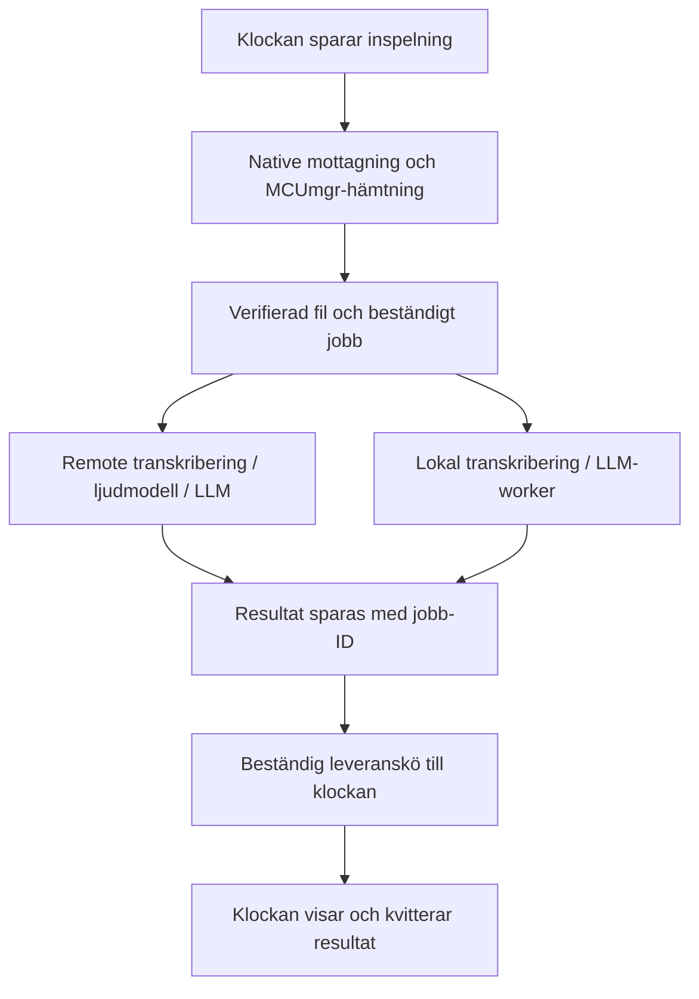

# HTTP, notificationer, tid och voice memos: uppdaterad arkitektur och Gadgetbridge-granskning

Datum: 2 oktober 2026. Kodgranskning och dokumentationsresearch; inga ändringar i appens implementation och inga verifierade telefonmätningar.

## Rekommendation efter de nya prioriteringarna

Behåll Flutter och befintliga lokala modeller. Gör HTTP, notificationer, tidssynk och mottagning av inspelningar till funktioner som kan fungera utan Flutter-gränssnittet. Gör transkribering och LLM-bearbetning till beständiga jobb med valbar lokal eller remote exekvering. Spara resultat och leverera dem till klockan även efter ett avbrott eller en senare återanslutning.

Detta utökar det kritiska bakgrundslagret jämfört med att enbart säkra BLE. På Android rekommenderar jag tjänsteägd kommunikation med Gadgetbridge som konkret referens. På iOS behövs CoreBluetooth-restoration, AccessorySetupKit där det stöds, samt native integration för bakgrundsöverföringar över nätverket. En Android-tjänst med egen Flutter-engine kan fortfarande vara ett alternativ, men måste klara inspelning, beständig lagring, HTTP och notificationer efter Activity/process-avbrott innan vi väljer den.

## Vilken Gadgetbridge-kod har granskats?

Den befintliga klonen finns i `/home/jakkra/Documents/ZSWatchApp/Gadgetbridge`, med Codeberg som origin. Den ligger på `790e18a9e3`, från 14 december 2025.

För att kontrollera aktuell kod klonades upstream separat till `/tmp/zswatch-gadgetbridge-research-20261002`. Den granskade revisionen är **`6cda126b7ec89838a1ded6309de96991c702b864`**, daterad 1 oktober 2026, med versionssträngen 0.94.0 i build-filen. Den befintliga klonen ändrades inte. Referenserna nedan är låsta till denna revision, inte till en framtida rörlig main-branch.

Jag hittade ingen ZSWatch-specifik supportklass eller voice-memo-handler i den granskade Java/Kotlin-koden. Bangle.js använder däremot samma NUS-service/characteristic-UUID:er som ZSWatchApp och motsvarande `GB(...)`, notification- och HTTP-meddelanden. Det ger relevanta byggblock, men är inte en färdig implementation av ZSWatchs utökade API eller MCUmgr-filflöde.

## Konkreta fynd i Gadgetbridge

| Del | Vad koden gör | Vad vi kan använda |
| --- | --- | --- |
| `DeviceCommunicationService` | Skapar device-support, registrerar receivers och startar foreground-status i tjänstens `onCreate`. Connect-kommandon skapar/ansluter native device-support. | Tjänsten som ägare av funktionell kommunikation, med UI som klient. |
| `GBCompanionDeviceService`, `BondingUtil`, `BluetoothConnectReceiver` | Registrerar companion-presence och använder närvaro/BT-händelser för återanslutning. Hanterar flera Android API-generationer. | Association/presence och återanslutning inom plattformens stöd. |
| `AutoStartReceiver` | Vid boot/appuppdatering kan den faktiskt anropa device-service connect, beroende på inställningar. | Rekonstruktion av kommunikation efter omstart, jämfört med ZSWatchApps nuvarande notification-only-start. |
| `NotificationListener` → `GBDeviceService` | NotificationListener anropar device-service-fasaden; fasaden skickar service-intents. | Notificationer ska inte gå via en callback installerad i en Activity. |
| `BtLEQueue` | Har separata native dispatch-/callback-trådar och serialiserade GATT-transaktioner. Innehåller hantering av disconnect, timeout och reconnect. | Serialisering, MTU/chunking, tillstånd och felhantering som referens. |
| `BangleJSDeviceSupport` | Tar emot JSON-kommandon; implementerar `http`, `notify`, `notify-` och tidssynk. | Närliggande protokoll för HTTP/notificationer/tid. Anpassning behövs för ZSWatch. |
| `TimeChangeReceiver`, `DeviceReceiversManager` | Tid-/tidszonshändelser, DST och periodisk synk hanteras med receivers/alarm. | Native tidsändringar och synk vid anslutning; undvik att en Dart-timer är enda mekanismen. |
| `ZeppOsVoiceMemosService` | Köar nedladdningar, skriver Opus-filer och lägger metadata i repository. | Mönstret för tjänsteägd filhämtning. Zepp-protokollet är ett annat än ZSWatchs. |

Källor: [kommunikationstjänsten](https://codeberg.org/Freeyourgadget/Gadgetbridge/src/commit/6cda126b7ec89838a1ded6309de96991c702b864/app/src/main/java/nodomain/freeyourgadget/gadgetbridge/service/DeviceCommunicationService.java), [companion-tjänsten](https://codeberg.org/Freeyourgadget/Gadgetbridge/src/commit/6cda126b7ec89838a1ded6309de96991c702b864/app/src/main/java/nodomain/freeyourgadget/gadgetbridge/service/GBCompanionDeviceService.java), [notificationer](https://codeberg.org/Freeyourgadget/Gadgetbridge/src/commit/6cda126b7ec89838a1ded6309de96991c702b864/app/src/main/java/nodomain/freeyourgadget/gadgetbridge/externalevents/NotificationListener.java), [BLE-kön](https://codeberg.org/Freeyourgadget/Gadgetbridge/src/commit/6cda126b7ec89838a1ded6309de96991c702b864/app/src/main/java/nodomain/freeyourgadget/gadgetbridge/service/btle/BtLEQueue.java), [Bangle.js](https://codeberg.org/Freeyourgadget/Gadgetbridge/src/commit/6cda126b7ec89838a1ded6309de96991c702b864/app/src/main/java/nodomain/freeyourgadget/gadgetbridge/service/devices/banglejs/BangleJSDeviceSupport.java), [tidssynk](https://codeberg.org/Freeyourgadget/Gadgetbridge/src/commit/6cda126b7ec89838a1ded6309de96991c702b864/app/src/main/java/nodomain/freeyourgadget/gadgetbridge/externalevents/TimeChangeReceiver.java), [Zepp voice memos](https://codeberg.org/Freeyourgadget/Gadgetbridge/src/commit/6cda126b7ec89838a1ded6309de96991c702b864/app/src/main/java/nodomain/freeyourgadget/gadgetbridge/service/devices/huami/zeppos/services/ZeppOsVoiceMemosService.java).

### HTTP: användbart, men inte en beständig jobbhanterare

I den äldre lokala Gadgetbridge-kopian använder Bangle.js Volley-köer. I aktuell upstream använder `handleHttp` istället `InternetUtils.doStringRequest`, med OkHttp eller en separat Internet Helper. Den hanterar metod, headers, body, XPath och request-ID, och skickar svaret över UART.

Build-konfigurationen har direkt internet avstängt i mainline och aktiverat i Bangle.js-flavorn; aktuell kod kan även använda Internet Helper. Därför ska vi inte dra slutsatsen att vanlig Gadgetbridge-installation automatiskt ger samma HTTP-beteende. ZSWatchApp har redan internetpermission och en egen HTTP-relay.

Jag skulle använda protokollkontraktet och native tjänsteägarskapet som referens, men implementera en avgränsad HTTP-executor för ZSWatch. Aktuell Bangle-kod använder ett synkront request-anrop i receive-vägen. Vi bör låta HTTP köras på en separat executor så att ett långsamt nätverksanrop inte blockerar fortsatt BLE-hantering. GATT-svar går tillbaka genom kommunikationskön.

Gadgetbridges GATT-kö är i minnet och töms vid vissa avbrott. Zepp voice-memo-kön är också i minnet. Dessa ersätter inte en databaslagrad kö för vår recording/AI/resultat-kedja.

### Direkt kodåteranvändning och paketering

Gadgetbridge-klasserna är tätt kopplade till `GBApplication`, device-coordinators, repositories, genererade entiteter, preferences och Android-resurser. `BangleJSDeviceSupport.java` ensam är över 2 400 rader och använder många app-specifika funktioner. Att importera hela klassen eller appen som en Flutter-plugin vore en större integration än en fokuserad ZSWatch-modul.

Min rekommendation är därför att återanvända arkitektur, beteenden och protokoll som referens, och utvärdera avgränsad kodextraktion separat. Gadgetbridge är **AGPL-3.0-or-later**, medan ZSWatchApp har **MIT**. Innan direkt kod kopieras behöver licensvalet för den integrationen vara bestämt. Inget Gadgetbridge-programkod har kopierats in i appen i denna research. Se [Gadgetbridges LICENSE](https://codeberg.org/Freeyourgadget/Gadgetbridge/src/commit/6cda126b7ec89838a1ded6309de96991c702b864/LICENSE) och ZSWatchApps lokala `LICENSE`.

För ZSWatchs filöverföringar är det mer direkt relevant att återanvända de Nordic MCUmgr-bibliotek som redan finns under er Flutter-wrapper än Zepp-klockans filprotokoll. Wrappern har redan native Kotlin/Swift-kod; vi behöver ändra dess livscykel och lagringsansvar snarare än uppfinna SMP på nytt.

## Voice memos: hållbar kedja med lokal och remote bearbetning

Separera två produktlöften: **inspelningen tas emot säkert** och **bearbetningsresultatet levereras när det är klart**. Kort fördröjning är ett mål att mäta; den beständiga kedjan ska tåla längre fördröjning och processavbrott.

1. Klockan behåller inspelningen tills telefonen har bekräftat en verifierad, varaktigt lagrad kopia. Identifiera inspelningen med klockidentitet och ett stabilt recording-ID.
2. Telefonen skriver en staging-fil, verifierar format/storlek och committar filen. Registrera sedan mottagning och AI-jobb i en databastransaktion innan radering på klockan tillåts. Återhämtning måste kunna hantera avbrott mellan filcommit och DB-commit.
3. Jobbet registrerar valt backend, aktuell fas, försök, senaste fel och eventuell remote-jobbidentitet. Alla pågående faser granskas vid återstart; ett lokalt inference-försök kan behöva börja om från sparad input.
4. Remote uppladdning/exekvering använder recording-ID som idempotency key där backend stöder det. Om backend erbjuder asynkrona jobb: skicka kort submit-request, spara jobb-ID och hämta resultat senare. Servern kan arbeta vidare utan att telefonprocessen lever. En backend med jobb-API kan vara egen eller tillhandahållen av leverantören.
5. Spara färdigt resultat och lägg watch-leverans i en outbox. Resultatet skickas på nytt vid nästa anslutning tills mottagning är kvitterad. Upprepad leverans ska inte skapa dubbla kalenderposter/reminders.
6. Håll radering på klockan, mottagen fil, färdigt AI-resultat och levererad watch-notis som separata tillstånd. Ett skickat delete-kommando är inte samma sak som en bekräftad radering.

### Remote LLM tar inte automatiskt bort lokal transkribering

Nuvarande `VoiceNoteAiPipeline` tar en färdig text och använder konkret `LlmService`; Whisper kör dessförinnan. Om bara text-LLM:n byts till remote ligger den tunga tal-till-text-delen fortfarande på telefonen.

Stöd separata val för transkribering och textbearbetning, samt en backend som kan ta ljud direkt. Föreslagna gränssnitt är exempelvis `TranscriptionBackend` och `VoiceAnalysisBackend`, med lokala respektive remote implementationer och samma beständiga jobbmodell. Behåll ljudfilen så att lokal bearbetning kan ske senare, även efter remote-fel. Backendvalet ska vara uttryckligt; inför ingen automatisk uppladdning som användaren inte valt.

### iOS och längre nätverksarbete

Använd native bakgrunds-`URLSession` för långvariga upload/download-steg. Överföringen hanteras av OS utanför appens process; uppladdningar som ska tåla app-exit behöver fil som källa. Återskapa session/delegates och koppla callbacken till DB-jobbet vid relaunch. Bakgrundsstartade överföringar kan schemaläggas med fördröjning. Se [Apple om bakgrundsöverföringar](https://developer.apple.com/documentation/foundation/downloading-files-in-the-background).

Gör inte en lång Dart HTTP-stream till villkoret för att jobbet överlever. För remote processing är en accepterad serveruppgift med beständigt jobb-ID robustare än att telefonen måste hålla en request öppen under hela inferensen. Resultat hämtas vid tillåtna bakgrundstillfällen eller nästa wakeup/anslutning; push kan hjälpa men ska inte vara enda återhämtningsvägen.

AccessorySetupKit/CoreBluetooths force-quit-regler innebär inte att en nätverksöverföring automatiskt har samma garanti. Apple dokumenterar separat att bakgrunds-URLSession-jobb kan avbrytas vid user force-quit. Jobbmodellen måste därför kunna försöka igen. Se [URLSession cancellation reasons](https://developer.apple.com/documentation/foundation/url-session-background-task-cancellation-reasons).

BLE-filhämtning är inte en URLSession-upload. Den behöver ett native transportflöde med restoration, kontrollerade avbrott och verkliga device-tester för både korta och långa inspelningar. Flera Bluetooth-callbacks under en legitim överföring kan ge fortsatta execution-tillfällen; tio sekunder ska inte tolkas som en universell maximal filstorlek eller filöverföringstid. Vi kan ändå inte anta att en femminuters Dart-timeout garanterar motsvarande CPU-tid.

### Lokala modeller finns kvar

Lokal bearbetning körs från sparad input i en worker och håller modellminne utanför återanslutningsvägen. På Android kan WorkManager användas för beständiga jobb, men långvariga workers har fortfarande quota-/servicekrav, inklusive Android 16-begränsningar. Välj exekvering efter uppgift och mätning. Se [Android om långvariga workers](https://developer.android.com/develop/background-work/background-tasks/persistent/how-to/long-running).

På iOS kan lokal bearbetning ske i förgrunden eller genom lämpligt schemalagt bakgrundsarbete. `BGContinuedProcessingTask` är relevant för arbete startat i förgrunden på iOS 26, men är inte en lösning för godtycklig kontinuerlig watch-startad inference. Behåll funktionen utan att lova omedelbar lokal inferens när appen är suspenderad. Se [Apple om continued processing](https://developer.apple.com/documentation/backgroundtasks/bgcontinuedprocessingtask).

## Konkreta gap i nuvarande ZSWatchApp

- `VoiceMemoSyncService` använder metadata över NUS och filer över MCUmgr. Biblioteket lämnar tillbaka hela filen till Dart när nedladdningen är klar. Native transport finns, men verifiering, filskrivning, DB och watch-delete utförs senare i Dart. Detta är den viktiga gränsen att flytta eller säkra.
- `_saveToLocalStorage` skriver filen direkt. Inför tydlig staging/commit och recovery innan den blir grund för radering på klockan.
- Metadatastatus sparas redan i SQLite, och AI-pipelinen återställer vissa fastnade tillstånd. Det är en användbar grund, men transport-/remote-jobb/outbox hanteras inte som en komplett beständig kedja.
- Auto-transkribering/AI startas av `onSyncCompleted` i provider-lagret. Körning efter process-restart behöver komma från jobbtabellen, inte enbart från en ny callback.
- `sendResultToWatch` skickar direkt; frånkopplad klocka får inget sparat leveransjobb där. Confirmation/undo bygger på in-memory timers. Spara resultatleverans och eventuella deadlines.
- Tid synkas redan vid anslutning, men Androids systemtid/tidszonshändelser behöver kopplas till den oberoende tjänsten. Klockans RTC håller tiden mellan synktillfällena.
- MCUmgr-pluginen skapar en egen `CBCentralManager()` vid pluginregistrering på iOS. ASK-migration får därför inte bara samordnas med FlutterBluePlus; även MCUmgr-starten måste granskas. Dess manager har inte explicit restoration-ID här.
- MCUmgr kan använda ett eget native transportobjekt. Ha en gemensam livscykel-/operationkoordinator för SMP, vanlig kommunikation och DFU; utgå inte från att två bibliotek delar samma GATT-handle.

Lokala källor: `zswatch_app/lib/services/voice_memo/voice_memo_sync_service.dart`, `zswatch_app/lib/providers/voice_memo_providers.dart`, `zswatch_app/lib/services/ai/voice_note_ai_pipeline.dart`, `zswatch_app/lib/data/database/tables/voice_memos_table.dart`, samt `Flutter-nRF-Connect-Device-Manager/{android,ios}`.

## Föreslagen första leverans och verifiering

Bygg en sammanhängande prototyp med befintliga Flutter-skärmar: native anslutning → notification och tid → HTTP → ny inspelning → verifierad fil och jobb → remote eller lokal bearbetning → sparat resultat till klockan. Låt HTTP och voice-receipt ingå från början. GPS kan följa som ett separat tillstånds-/permissionsflöde.

Verifiera att mobilen kan vara låst och UI stängt. Avbryt processen vid varje gräns: mitt i BLE-fil, efter filcommit, före watch-delete, under upload, efter remote-accept, efter färdigt resultat och innan watch-kvittens. Kräv att inspelningen återfinns, jobbet kan återupptas/omköras, och att inga dubbla externa actions skapas. Testa olika inspelningslängder och flera inspelningar i följd. För Android och iOS dokumenteras systemtermination och user-stop/force-quit separat.

Detta underlag gör mig mer övertygad om Flutter som UI med en native companion-kärna och beständiga jobb. Gadgetbridge ger en konkret Android-referens; befintlig MCUmgr-wrapper ger relevant Kotlin/Swift-kod för ZSWatch-filer; befintliga lokala modeller kan fortsätta användas bakom det nya jobbgränssnittet.
